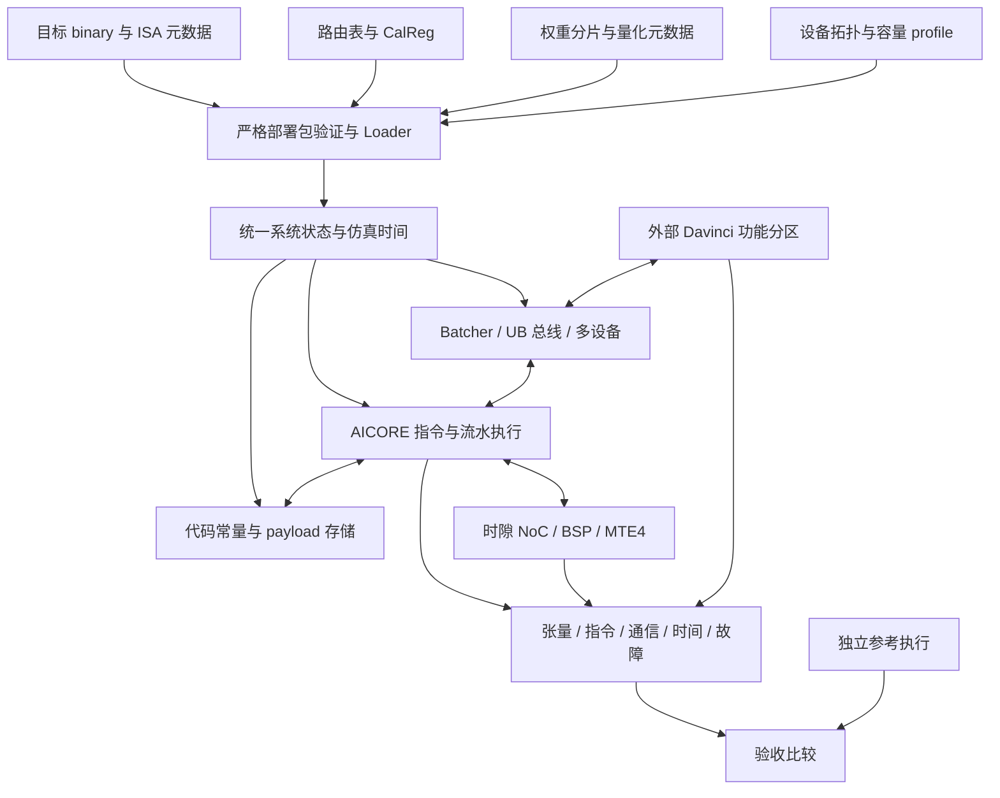

# WSE ESL 系统建设路线图：DeepSeek-V4-Pro 端到端推理

> 目标基线：2026-09-29。本文规定 `wse-model` 从架构契约模型演进为可执行 ESL 系统的目标、交付顺序和验收标准。

## 1. 仓库目标与系统边界

本仓库要交付一个由真实部署产物驱动的 WSE ESL 系统：装载外部生成的 Calendar 路由表、CalReg 时隙镜像、WSE 目标机器码和真实权重，在声明的设备容量、计算资源、通信与同步约束下完成 DeepSeek-V4-Pro 的端到端推理，并给出可复现的数值结果和可解释的执行时间。

路线图沿用[系统白皮书](wse-system-architecture-whitepaper.md)、[Calendar 方案](wse-calendar-scheme.md)和[已接受的架构决策](../decisions/index.md)。已有模块的实现状态见[仓库状态路线图](../roadmap.md)；本文以 M0–M9 定义系统建设的交付路径。

### 1.1 已确定的目标基线

| 项目 | 执行基线 |
| --- | --- |
| 首个端到端边界 | 当前白皮书的三分离部署，加外部 Davinci 功能分区 |
| WSE 部署形态 | FFN 与 Attention 投影是两类角色；每类角色均可由多个 Reticle/die 承担，数量由容量和互连方案确定 |
| 模型候选 | 官方 `deepseek-ai/DeepSeek-V4-Pro-0813`，候选 revision 固定为 `72e1d3230f6c080a530b0a1d46f8eb4602340597`；M0 核验并固化模型、tokenizer、配置和权重 hash，运行不跟随可变的 `main` |
| 首次功能验收 | 真实主干权重、全部主干层、prefill 和多步 decode；MTP/DSpark 等推测解码单独验收，属于可选扩展 |
| 系统实现前置条件 | 先完成 M0 的容量证明、目标 ISA 执行路径和 CalReg 提供者交付，再进入 M1–M9 系统实现 |
| 推进顺序 | 按 M0–M9 的依赖和退出门槛推进；原生归约、PG 重映射和长上下文均有独立交付与验收安排 |

### 1.2 各分区职责

| 分区 | 本路线图中的职责 |
| --- | --- |
| WSE-Lite FFN 子系统 | 执行部署到 WSE 的路由专家、共享专家及分发、拼接、加权合并中划归 WSE 的操作 |
| WSE-Lite 投影子系统 | 执行实际模型图中划归 WSE 的 Attention 投影及配套操作 |
| 外部 Davinci 功能模型 | 执行 Attention 主体、KV/压缩状态、控制流、采样及其他划归外部分区的操作；初期通过显式请求/响应接口接入确定性的 CPU/GPU 功能模块 |
| Host 与仿真运行器 | 完成模型装载、请求组织、全局推进、结果检查和报告 |

WSE 分区内的计算必须由目标 binary 驱动。外部 Davinci 功能模型与独立整模型 oracle 分别接入，记录各自的状态与输出；不得把 WSE 算子交给 oracle 执行后计为系统通过。外部设备的数值、状态、通信字节和时间假设同样纳入观测。

### 1.3 完成标准

- 路由、时隙、binary、权重、设备配置和运行请求构成版本及内容绑定的部署包，可重复装载。
- binary 实际驱动张量读写、计算、通信和同步；目标设备容量与资源限制在执行中生效。
- 完整 checkpoint 完成 `prompt → prefill → 全部主干层 → 多步 decode → logits/token`，与独立参考执行对照。
- 同一执行链产生数值与时间结果，可追踪时隙、排队、同步、计算和传输如何决定完成时刻。
- 每项验收保留运行命令、工具链 revision、产物 hash、误差阈值、执行 trace、故障诊断和宿主资源预算。

单核、小模型、缩小形状、单层、随机权重和通信 trace 用于阶段验证；完整模型验收使用完整主干与真实权重。RTL 综合、真实硬件运行、所有精度组合及可选推测解码分别记录支持范围。未校准的硬件时间参数以显式假设报告。

## 2. 建设起点与交付责任

以仓库提交 `b0f714e65b3cefc0993d2598cc21d664585ab188` 为建设起点，已有能力主要处于契约校验和解析建模层。

| 领域 | 可复用基础 | 本路线图要交付的能力 |
| --- | --- | --- |
| Calendar 与 NoC | 编码、路由结构校验、AllGather 字节守恒、CalReg 安装约束 | 外部产物导入、真实 payload、时隙放行、有限队列、逐跳传输与同步 |
| AICORE 与存储 | 流水约束、容量公式、Cube/Vector 吞吐估算 | 取指译码、张量数值执行、真实存储、地址权限、数据搬运与提交 |
| Loader、Runtime、Batcher | 声明式产物检查、版本和装载顺序、流量公式 | 严格可运行包、任务队列、统一设备状态、多轮 launch 和多设备运行 |
| 工作负载 | 固定 FFN 两相通信 fixture | 真实模型权重、算子分区、动态 MoE、Attention 状态和完整 token 循环 |
| ACIR 与验证 | 可 lower 的节点规则原型、纯 Python 语义测试 | 生成式后端实际执行、跨事件持久状态、多节点与全系统差分 |

本仓库负责 WSE 的装载与执行组合、编码合法性、守恒、调度、容量和性能语义。外部依赖以明确的输入样本、版本和消费接口进入里程碑：

| 交付方 | 外部交付 | 本仓库责任 |
| --- | --- | --- |
| 编译器与目标 ISA 后端 | 可执行 WSE binary、ISA/ABI、扩展指令和功能后端接口 | 装载、适配、资源时序、状态连接与执行验证 |
| Calendar/NoC 提供者 | 同源路由与 CalReg、格式或解释模型、保证前提 | 严格导入、执行时隙、校验 payload 与时间行为 |
| 模型与参考后端 | 固定 checkpoint、数值格式、tokenizer、独立参考结果 | 权重布局、设备分区、完整推理与数值对照 |
| pyCircuit 与 PTO 上游 | 建模语言、生成式后端、PTO 规范与指令语义 | 固定消费版本、实现 WSE 模型、开展两层语义差分 |

纯 Python 核心继续作为架构契约的语义依据。框架与 PTO 指令语义由相应上游维护；Calendar 求解器由提供者交付。本仓库通过适配与校验消费这些能力。pyCircuit 生成的宿主仿真器和被模拟的 WSE kernel binary 在产物及报告中分别标识。

## 3. 目标执行链与部署契约

部署包需实现以下契约；它们是里程碑交付要求，不代表现有接口已经支持。

| 输入 | 必需内容及一致性要求 |
| --- | --- |
| 设备 profile | 设备/Reticle/节点/AICORE 映射、链路与 PG、容量和地址域、时钟与时延参数、精度能力及参数来源 |
| 目标 binary | ISA/ABI、入口 PC/SP、装载段与权限、符号/重定位、编译器 revision、内容 hash |
| 路由产物 | 每 key/node 表项、布局、group/rank、几何与版本；核对 `.rodata` 实际字节和 LD 寻址 |
| CalReg 产物 | 格式/解释器版本、节点/端口/opcode 镜像、服务周期、arm 约束、校验值和路由同源标识 |
| 权重 manifest | checkpoint revision、tensor 名称/shape/dtype、scale、分片与地址、校验值、逐核占用 |
| 执行计划 | 入口与参数、分区职责、完整 group、phase/launch DAG、并发关系、张量布局和状态归属 |
| 工作负载与参考 | tokenizer/消息编码、输入 token、prefill/decode 长度、batch、采样方式、参考版本和误差标准 |

保留 topology/calendar/route 三版本联合校验，并绑定内容 hash 和生产工具 revision。常规部署中路由表随 `.rodata` 装载、CalReg 独立安装到 NoC、权重驻留于各核 local DRAM；PG 重映射的表装载路径按第 5 节验收。

## 4. 里程碑与依赖

M0 是完整系统实现的前置关卡。通过后，M3 与 M4 可并行建设，M6 与 M7 可并行建设；退出门槛按依赖验收。参考张量、生产侧对接、资源微基准与 ACIR 差分随各阶段持续积累。

### M0 — 完成容量、ISA 与 CalReg 前置交付

**依赖：** 第 1 节的目标基线。

- [ ] 核验固定候选 revision，固化模型配置、真实权重、tokenizer、主干算子清单及 hash；分别定义首次功能与可选推测解码的运行配置。
- [ ] 按三分离边界生成逐 tensor/算子归属，确定两类 WSE 角色的 Reticle/die 数量、互连、权重分布和余量；统计 scale、padding、复制、工作空间以及外部 KV/压缩状态的容量。
- [ ] 取得包含 WSE 相关指令的最小真实 binary、ISA/ABI 与执行后端接口，完成控制/访存能力探针；记录 Calendar、地址空间、低精度扩展的提供方、版本、负责人和交付要求。
- [ ] 取得同一次生产调用生成的真实路由和 CalReg 样本，交付格式或可调用解释模型、服务周期、arm 约束、冲突与迟到行为、保证前提及接口负责人。
- [ ] 固化首期精度、误差阈值、参考张量获取方法、功能与时间参数来源；明确原生归约使用范围、PG 重映射支持范围、长上下文长度/batch 阶梯及宿主预算。

容量证明必须逐核成立。按候选配置的 `61 × 384` 个路由专家、每专家 `3 × 7168 × 3072` 个 FP4 元素计算，仅原始路由专家权重就有 `773,698,093,056 B = 720.5625 GiB`。以当前代码的 `384 MiB/AICORE` 计，40 个计算核只有 `15 GiB/Reticle`；仅该部分权重的算术下界已是 49 个这样的 Reticle。此估算尚未包含 scale、共享专家、投影和工作空间，M0 必须以实际权重与映射重新核算。模型配置依据[固定 revision 的 config](https://huggingface.co/deepseek-ai/DeepSeek-V4-Pro-0813/blob/72e1d3230f6c080a530b0a1d46f8eb4602340597/config.json)及[推理实现](https://huggingface.co/deepseek-ai/DeepSeek-V4-Pro-0813/blob/72e1d3230f6c080a530b0a1d46f8eb4602340597/inference/model.py)，容量口径见 [platform.py](../../src/wse_model/analysis/platform.py)。

物理节点数与 AICORE 数分别计入 profile，保留 40/48 节点的明确支持边界。权重按目标侧容量驻留；宿主 mmap/惰性映射不能替代容量证明。逐层从外部流送权重会改变驻留假设，采用前需有对应架构决策并计入全部流量和时延。

**交付物：** 模型/设备 manifest、容量与部署报告、接口契约、最小 binary/Calendar 样本、能力探针结果、验收配置。

**退出门槛：** 容量方案可行，目标 binary 的执行路径可验证，CalReg 有可执行解释契约，外部交付责任明确。三项均满足后进入 M1；材料不全时继续完成本阶段核验与静态分析。

### M1 — 统一部署产物与严格装载契约

**依赖：** M0。

- [ ] 实现部署包、CalReg、权重与执行计划 schema，以及真实生产产物导入适配。
- [ ] 从 binary 提取段、符号与重定位，核对 F1/F2/F3、表字节、entry PC、opcode 立即数和 ISA 兼容性。
- [ ] 绑定路由、CalReg、binary、权重的内容与版本；校验完整 group、并发计划及 `conflictProof` 的输入/输出 hash 和保证前提。
- [ ] 明确支持的节点/epoch 位宽与表布局；48 节点下现有 16 B 表项无法容纳的配置须拒绝，扩展须先形成编码契约。
- [ ] 固定 pyCircuit 和生产工具版本，建立需求、实现、测试、产物的对应关系；为 Python/ACIR 差异建立行为反例。

**交付物：** 最小可运行包、严格 validator、反例包集、支持配置与双层语义覆盖表。

**退出门槛：** 正常包完整 round-trip；缺 binary/权重/CalReg、缺必需 opcode、未知格式、内容篡改及版本/拓扑错配均在运行前定位拒绝。

### M2 — 建立真实存储与统一事件底座

**依赖：** M1。

- [ ] 由统一系统对象管理设备、核、存储、任务、NoC、BSP、错误与 drain 状态。
- [ ] 实现代码/常量、Batcher.mem、local DRAM、L0A/B/C、L1、UB 的真实字节或等价张量存储，执行容量、地址、权限和生命周期检查。
- [ ] 实现二维搬运、自拷贝和内存提交；MTE4 的 committed 与写入实际可读关联。
- [ ] 实现确定性事件推进、同刻事件顺序、多时钟域转换和完成事件，明确每个上下文的 reset/abort/launch/drain 行为。
- [ ] 接通 ACIR/生成式后端的多事件运行，与 Python 对照持久状态、输出和 fault；诊断包含任务、PC、pipe、queue、opcode/epoch 和待收字节。

**交付物：** 单核/双节点底座、真实存储后端、事件日志和后端差分入口。

**退出门槛：** 非零数据经过搬运与提交后可正确读取；越界、未提交读、重复投递和 reset 后旧事件有确定结果；系统进度及排空由真实事件产生。

### M3 — 单 AICORE 执行目标 binary

**依赖：** M2 与 M0 的 ISA 后端。

- [ ] Loader 映射 `.text/.rodata`、参数和栈，设置 PC/SP/blockId；由取指、译码、分支、寄存器读写推进到终止。
- [ ] 接通 Scalar、MTE、Cube、Vector、FixPipe 与事件依赖，执行工作负载所需的指令子集，未支持指令明确 fault。
- [ ] 分别落实 DDR → Batcher.mem → I$/D$ 的代码/常量通路，以及 local DRAM → 片上 buffer 的 payload 通路。
- [ ] 实现 M0 固定的首期数值路径，并补齐目标 FP8/FP4 的格式、scale、转换、累加和舍入。
- [ ] 用真实 producer/consumer 验证 RAW、TSYNC、barrier、写回，以及 MTE4 等待时其他独立流水的推进。

**交付物：** `binary + weights + input → output` 单核运行器和数值用例。

**退出门槛：** 独立编译的非平凡 kernel 经装载得到正确张量；修改代码或权重能按预期改变结果；非法指令和依赖错误可定位到 PC。

### M4 — 由真实时隙表驱动多核通信与同步

**依赖：** M2；可与 M3 并行，随后接入真实 SEND/RECV 指令。

- [ ] 执行提供者定义的 CalReg、每 opcode 有限队列、周期放行、逐跳链路占用、flit 复制与 payload 落核，分别计量有效字节和 padding。
- [ ] 实现 BSP 全组到齐、时间原点与 arm 窗口，同步容量覆盖目标 group；落实 MTE3 入队/排空、MTE4 记账/退休与内存提交的关联。
- [ ] 覆盖早到、乱序、跨 burst、self-delivery/本地自拷贝、重复片段、错误范围/epoch、wrap 和 launch drain。
- [ ] 验证不同 payload 长度、跨周期、注入偏斜与背压下的计划；错相、超 arm、缺成员、队列满、非法同 opcode 并发和冲突计划给出明确诊断。
- [ ] 将 ACIR 扩展为有真实连接和持久状态的多节点执行，比较高编号节点、各 opcode、不同 epoch 位宽与跨轮状态。

**交付物：** 双节点、小 mesh、40-node/32-active FFN 场景，逐链路时间线与实际接收张量。

**退出门槛：** 数值、布局、远端计量和本地段均正确；改变合法时隙改变发送/完成时间并保持数值，无效时隙导致失败。`conflictProof` 和静态树遍历需有实际执行证据支撑。

### M5 — 贯通单 Reticle 装载、运行与回收

**依赖：** M3 + M4。

- [ ] 实现 Batcher 请求入口、任务/参数分发、输入搬运、核启动、输出汇收和完成队列。
- [ ] 将 I$/D$ 回填和输入/输出事务接入同一个有限容量的 Batcher，记录共享资源竞争及 cold/warm 状态。
- [ ] Runtime 按完整 group 和 phase DAG 调度；CalReg 安装具备排空、提交、失败语义，版本校验与实际设备状态关联。
- [ ] 完成连续 launch，验证 epoch 初始化、迟到隔离、内存与 descriptor 回收。
- [ ] 运行“本地计算 → 实际 AllGather → 消费接收张量继续计算 → 回传”的多核 binary。

**交付物：** 单 Reticle 运行命令、部署包、多轮输出与因果 trace。

**退出门槛：** 仅凭输入产物和任务即可完成运行；移除发送或阻断写入会使消费者等待/报错；至少两次 launch 后相关状态正确回收。

### M6 — 完成真实模型算子与 WSE 分区

**依赖：** M5；模型清单与参考结果从 M0 开始准备。

- [ ] 实现真实 checkpoint 读取、格式转换、逐核切分和地址分配，逐 tensor 核对 hash、转置、padding、scale 及存储占用。
- [ ] 从稠密投影推进到完整专家 FFN、共享专家和多专家加权组合，实际执行 gate/up、SwiGLU、down 与拼接。
- [ ] 接通 hash/score 专家路由和 token dispatch/combine，将动态负载映射到静态 Calendar，覆盖冷门专家、空核与最坏倾斜。
- [ ] 按全组参与约束 E1 处理零有效 token；padding 计入真实带宽，变长方案重新核对各成员 `expVal` 与服务计划。
- [ ] 按实际图接通低秩 Q、共享 KV、分组 O 等投影；逐算子落实 norm/量化、compressor/indexer 的归属，重新计算边界张量与往返次数。
- [ ] 实现所需 collective 路径，交付第 5.1 节的原生归约契约与测试。使用原生归约的分区须先通过其验收；采用 AllGather 加本地计算的分解路径须证明数值、资源和顺序正确。

**交付物：** 算子覆盖清单、权重布局工具、V4 分区 binary、数值 golden、动态 MoE 压力场景、归约验收记录。

**退出门槛：** 所有实际执行分支都有支持路径，逐张量结果与参考对齐；量化、分片拼回、共享专家与加权组合实际执行，WSE 分区无隐式 host fallback。

### M7 — 多 Reticle/die 与外部 Davinci 协同

**依赖：** M5 与 M0 的容量方案；可与 M6 并行。

- [ ] 实例化两类 WSE 角色所需的 Reticle、Batcher 和外部链路，落实全局地址、张量分片、同步域和请求路由。
- [ ] 实现 UB 请求/响应、固定延迟、共享带宽、有限队列、背压与异步完成，检查实际输入/输出字节。
- [ ] 接入 Davinci 功能分区的 Attention、KV/压缩状态及其余外部算子；每个边界携带 shape、dtype、layout、请求身份和完成依赖。
- [ ] 按目标容量保持权重驻留，验证同 opcode 跨物理域隔离、同域串行约束、同步偏斜、故障退出和多请求状态隔离。
- [ ] 实现第 5.2 节的 PG 校验、按实例重新部署与恢复路径，交付坏核/坏链样本及替代部署产物。

**交付物：** 容量可行的多设备实例、外部分区适配器、跨设备 trace、PG 重映射部署与故障用例。

**退出门槛：** 请求跨 WSE/Davinci 完成并与参考一致，驻留量、通信量和共享资源与 manifest 一致；PG 不匹配的旧包必须拒绝，重映射功能按第 5.2 节单独记录验收结果。

### M8 — 完整 checkpoint 的首次功能验收

**依赖：** M6 + M7 的模型执行路径。

- [ ] 由真实权重 block 推进到全部主干层，覆盖 hash/score 路由和不同压缩 Attention 配置；验证 mHC、压缩器/indexer、KV 状态的连续性。
- [ ] 接通 tokenizer、消息编码、prefill、logits、至少两个连续 decode token、停止条件和状态清理；外部 prefill 产生的 KV/压缩状态须真实并与 decode 一致。
- [ ] 逐层/逐边界比较 hidden state、专家选择/权重、必要的 Attention 状态和 logits；以同精度确定性样本核对 greedy token，记录误差阈值、tie 处理和量化偏差。
- [ ] 覆盖不同 batch、多个请求、极端专家倾斜，以及第 5.3 节的滑窗/压缩边界和分段 prefill，支持定位到 layer/operator/device/core/PC。
- [ ] 以关闭推测解码的主干执行完成首次验收；可选 MTP/DSpark 按第 5.4 节另行交付。

**交付物：** 完整系统运行命令、真实模型 manifest、全层数值与 token 报告、可复现回归样本。

**退出门槛：** 完整主干、真实权重、prefill 与多步 decode 通过独立参考检查；每次 WSE 调用可追溯到 binary 和真实数据流。首次验收报告明确 collective 实现路径、拓扑/PG、上下文长度与 batch。

### M9 — 时间、规模与系统工程验收

**依赖：** M8；微基准和资源测量从 M2 起积累。

- [ ] 为计算、local DRAM、I$/D$、Batcher、NoC、外部链路建立微基准，按提供者模型、RTL 或硬件证据校准；无证据的参数保留假设标签。
- [ ] 输出冷启动、prefill、decode 每 token/每层时间、关键路径、跨设备等待、链路利用率、队列峰值、cache miss 与权重/激活字节。
- [ ] 用依赖图计算重叠，保留 [ADR 0006](../decisions/0006-two-roofline-verdicts.md) 的两种 roofline 口径，分别报告理论下界、事件仿真时间、宿主耗时和硬件校准结果。
- [ ] 完成 C++/批量推进、空闲跳跃、检查点和有限 trace 等必要的规模优化，证明加速模式在支持范围内与精细模式数值、顺序和资源计费等价。
- [ ] 收口原生归约、PG 重映射与长上下文专项验收，报告数值、恢复、容量、时间和宿主预算；分别保留各专项的完成证据。
- [ ] 建立轻量回归、生成式后端差分、多节点 nightly、真实权重受控大测试，交付使用文档与明确的支持矩阵。

**交付物：** 可重复运行的系统、分层回归门禁、校准/敏感性报告、三项专项报告、运行预算和使用文档。

**退出门槛：** M0–M8 及第 5.1–5.3 节的目标范围全部通过，完整模型可在声明的宿主预算内重复运行；资源/时隙扰动产生符合因果关系的变化，时间结论注明证据等级。

## 5. 专项交付与验收

首次功能闭环与系统建设完成分别记录。M8 可使用已验证的归约分解路径和正常拓扑；原生归约与 PG 重映射仍按下列计划推进，并在 M9 收口。长上下文的状态正确性从 M8 验证，目标规模与容量在 M9 验收。三项范围在 M0 固化，变更须同步更新验收配置与本路线图。

### 5.1 原生归约：M6 建设，M9 收口

**目标：** 支持声明范围内的原生 Reduce/AllReduce/ReduceScatter，形成真实数值 merge 与逐 shard 路由能力。若模型 binary 使用该能力，其通过时间前移到对应 M6 算子验收之前。

- [ ] 交付元素 dtype、redOp、累加精度、舍入/溢出/饱和规则，以及 `{P,L}` 下的归约点、参与者和完成条件；用实现规格/ADR 承接 C-3/C-10。
- [ ] 实现有限 merge 缓冲、乱序到达、背压、去重与 epoch 隔离；依 C-8 交付逐 shard 表形状、地址和驻留预算。
- [ ] 覆盖不同 group 大小、多 dtype/redOp、乱序/重复/缺失贡献、merge 缓冲满，以及 ReduceScatter 的 shard 归属与边界。
- [ ] 将原生路径与独立数值参考及已验证的分解路径对照，报告误差、归约顺序、链路字节、缓冲峰值和完成时间。

**验收标准：** 输出、贡献计数、shard 落点和退休时刻满足契约；重复贡献不重复累加，缺失贡献不能提前完成。分解路径的成功仅证明该分解路径；原生能力需有实际 merge 执行证据。

### 5.2 PG 重映射：M7 建设，M9 收口

**目标：** 支持 Partial Good 芯片实例的坏核/坏链屏蔽、合法重映射和重新部署。验收以装载期重映射、运行中故障安全退出后重新装载为基线。

- [ ] 将 PG、逻辑核到物理节点映射及拓扑版本纳入部署包；按 Q12/C-11 形成支持契约，拒绝与实例不匹配的旧包。
- [ ] 接收提供者针对新拓扑重算的路由与 CalReg，同步更新 group/rank、权重分片、地址、容量和版本/hash；核对 Calendar §3.11 的 B 类只读表装载、基址传递及额外访存/下发成本。
- [ ] 覆盖单坏核、单坏链、可绕行多故障、网络分区、容量不足及无可行映射；合法方案验证实际 payload 和多核计算，非法方案在装载前拒绝。
- [ ] 覆盖运行中故障后的 abort/drain/reset、重新装载与重试，防止旧包、旧 epoch 和迟到数据污染新运行。

**验收标准：** 重映射前后同一逻辑工作负载的数值一致；执行不访问禁用节点/链路，新容量与资源开销真实计入；失败可诊断，重新部署后可重复运行。无中断热迁移需另行定义状态转移契约与验收。

### 5.3 长上下文：M8 状态验证，M9 规模验收

**目标：** 在 M0 固定的长度、batch 与设备/宿主预算内完成长序列 prefill 和多步 decode，验证 KV、滑窗、压缩与索引状态随长度增长的正确性和成本。

- [ ] 从固定 revision 提取窗口、压缩与位置规则，建立各边界前一 token、边界位置、后一 token 以及长度递增到验收上限的测试阶梯。
- [ ] 对照整段与分段 prefill，覆盖跨滑窗、跨压缩块、历史保留/淘汰和多请求隔离；核对可用的逐层状态、logits 与连续 decode token。
- [ ] 测量各外部分区和 WSE 边界的 KV/压缩/indexer 状态、工作空间、实际流量、prefill 时间、decode 时间及峰值内存。
- [ ] 在验收上限运行完整主干与真实权重；超过已声明容量或长度的请求须有明确拒绝和诊断。

**验收标准：** 状态边界连续、数值符合固定阈值、资源峰值处于预算内，时间与流量随长度变化可解释。报告同时列出模型配置上限与实际验证上限；短上下文通过不能代替长上下文验收。

### 5.4 可选推测解码：M8 之后独立验收

MTP/DSpark 在首次主干功能验收之外推进，固定其权重、配置和运行版本，分别验证 draft、verify、接受/拒绝、KV/压缩状态回滚及停止条件。通过后再测量有效 token 吞吐、额外计算/通信与状态容量；该结果不改变已完成的主干功能验收口径。

## 6. 验证阶梯与完成记录

| 层次 | 必需执行证据 |
| --- | --- |
| 产物契约 | 实际包解析、schema、三版本/hash、必需内容与错误包拒绝 |
| 单元语义 | 编码、精确位宽、守恒、epoch、数值、地址与故障反例 |
| 后端一致性 | 同输入序列在 Python 与实际生成式后端执行，比较持久状态、输出与 fault |
| 单核执行 | 独立编译 binary 经 Loader 消费真实权重并写回正确张量 |
| 网络执行 | 真实 payload、时隙与有限资源；乱序、重复、早到及提交行为 |
| 系统执行 | 统一 Loader/Runtime/NoC，单 Reticle、多设备与跨 launch 生命周期 |
| 模型功能 | 真实算子、block、全部主干层、prefill、多步 decode 与参考对照 |
| 专项能力 | 原生归约、PG 重映射和长上下文各自的正例、反例及资源报告 |
| 系统时间 | 因果 trace、共享资源竞争、微基准、参数扰动和校准证据 |

ACIR 差分随主线覆盖参数化 route/epoch 位宽、真实邻居转发、跨 event 状态回写、活动 receive 上下文匹配、`(source, seq)` 去重身份、内存提交和计数溢出。可 lower 与可执行分别记录。

每个里程碑完成时附输入样本、代码与工具版本、运行命令、测试结果、产物 hash 和支持范围。系统建设完成需逐项具备以下记录：

- [ ] M0 的模型、容量、ISA、CalReg 交付完整，设备分工和验收配置已固化。
- [ ] 外部路由、时隙、binary 和权重通过严格装载链路，执行无 WSE 分区隐式回退。
- [ ] 单核、多核、单 Reticle、多设备及多轮生命周期有实际执行证据。
- [ ] 完整主干、真实权重、prefill 与多步 decode 通过独立参考检查。
- [ ] 原生归约、PG 重映射和长上下文按各自目标范围通过专项验收。
- [ ] 数值与时间可追溯，硬件假设、未支持配置与可选扩展在支持矩阵中明确列出。
- [ ] 生成式后端差分、分层回归、规模预算、使用文档和重现命令齐全。
