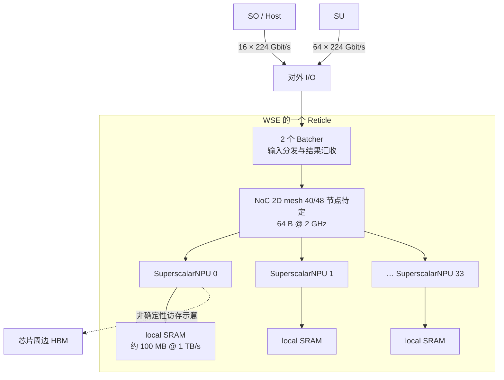
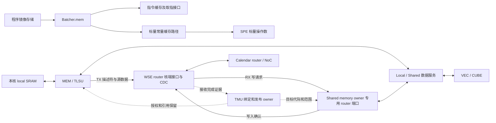
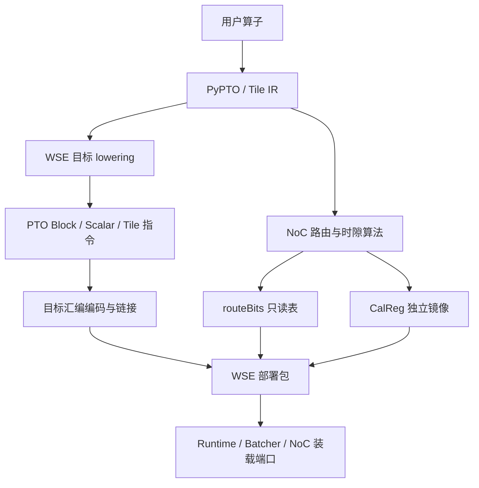
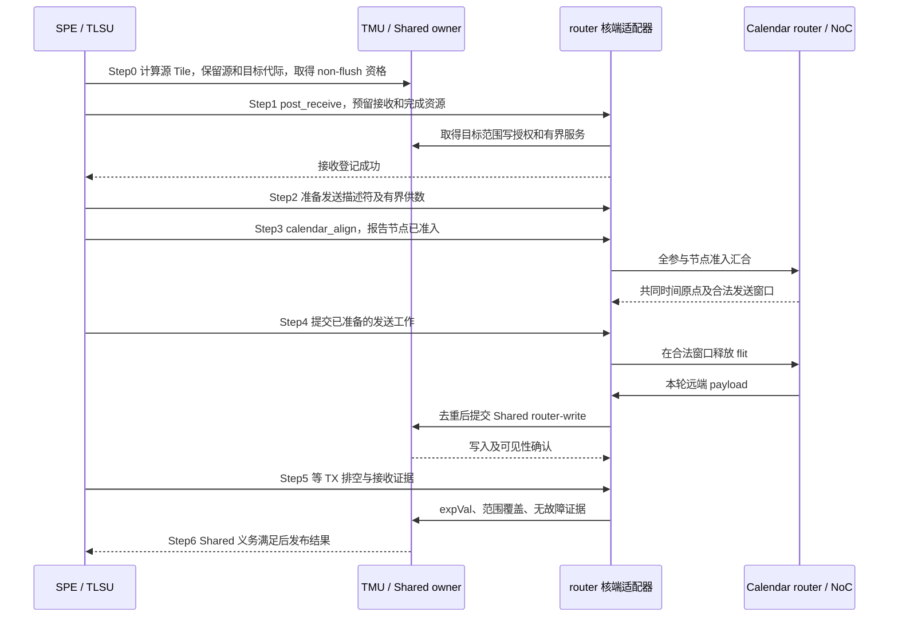
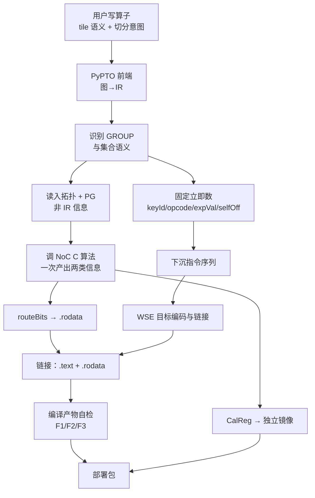
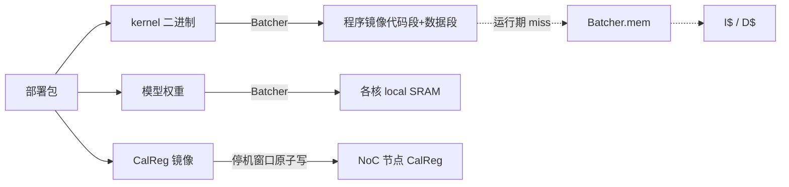
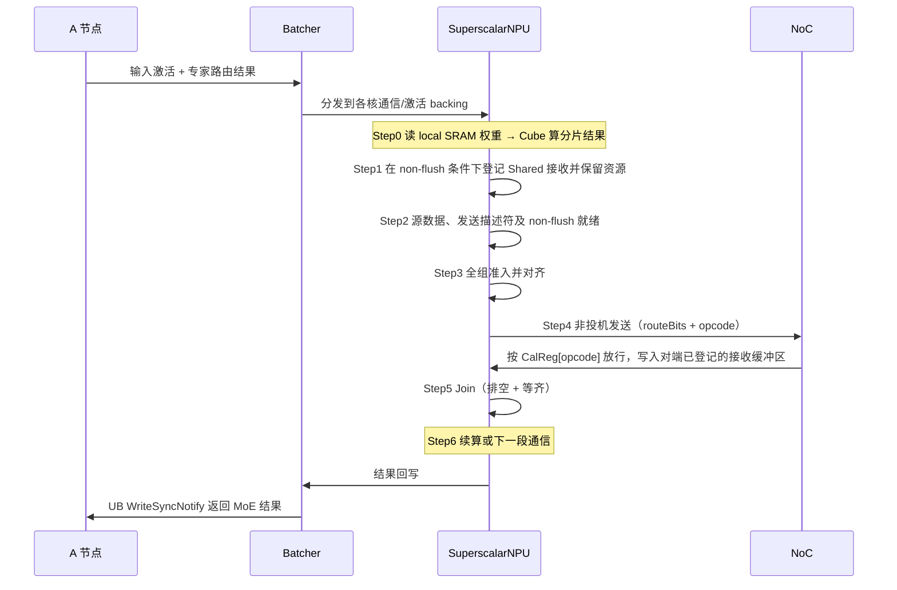
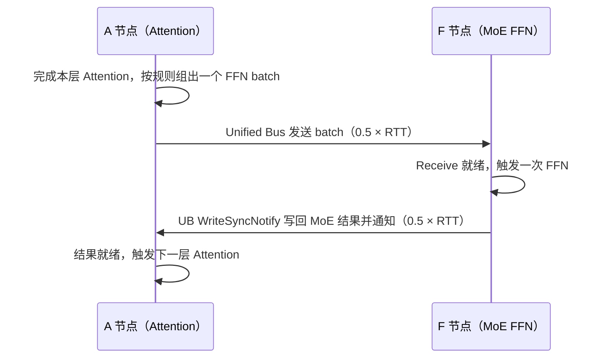

# WSE 系统架构设计白皮书

*软硬件一体系统设计文档 · 版本 v0.3（Decode 架构草案）*

2026-11-13

## 摘要

WSE 面向大模型生成文本时的解码（decode）。模型先处理已有输入（prefill），再利用已有上下文逐步生成后续 token。一次解码步需要依次执行多层计算。本文用 **A** 表示负责注意力计算（Attention）的节点，用 **F** 表示负责混合专家前馈网络（MoE FFN）的节点。A 和 F 标识计算职责，具体部署位置见第 18 节。

WSE 将反复使用的权重放在各个 SuperscalarNPU 计算核旁的本地 SRAM。以 F 为例，输入激活到达后，计算核可以就近读取专家权重。若同一矩阵分放在多个核上，各核先计算自己负责的分片，再通过片上网络（NoC）交换中间结果。WSE 的硬件设计同时支持两种跨核访问模型。核需要按运行时索引读取另一核的数据时，可以使用分区全局地址空间（PGAS）随机互访。多个核按约定顺序交换分片时，可以使用集合通信，由 Calendar 预先安排路径和发送时隙。两类流量竞争同一传输资源时，集合通信享有绝对优先级，PGAS 使用剩余带宽。

WSE 重点面向 decode 的两种工作点：高吞吐场景的 Batch Size ≤ 64；低时延场景采用 Batch = 1、MTP = 7。Batch 统计一起执行的请求数。MTP（多 token 预测）是单独的配置维度，单轮实际产出的 token 数取决于运行结果。

### 从一个请求看一次 decode

以一个已有 **128 个 token 上下文**的请求为例。128 只是讲解用的长度。沿这个请求观察一次启动和相邻两层之间的数据流，就能看出各部件分别在等什么。

| 时刻 | 发生的事 | 下一步为什么能开始 |
|---|---|---|
| 等待输入 | 管理实体由 4 个 Batcher 和 4 个 SRAM 组成。它准备启动这个请求所在的 batch，经 SO 通路加载 prefill 结果。 | 启动点处于等待状态（stall），直到输入和启动参数都已就绪。 |
| 启动 batch | 本例设置 batch size = 1、KV length = 128。KV length 表示 Attention 可引用的历史键值位置数。管理实体发起一次常驻程序（persistent kernel），覆盖 Attention 和 FFN。 | 程序在本 batch 的自回归执行期间保持运行。后续各层可以由数据就绪事件推进。 |
| A 交给 F | A 完成第 ℓ 层 Attention，将要交给 FFN 的激活按组批规则组织起来，经 Unified Bus（UB）发送。 | F 的 Receive 就绪，表示这次 FFN 的输入已到，可以触发一次计算。 |
| F 交回 A | F 计算 MoE 结果，经 UB 执行 `WriteSyncNotify`，写回结果并通知 A。 | A 收到此次结果的就绪通知，才能消费它并开始第 ℓ+1 层 Attention。此时仍在同一次 kernel 启动内。 |

第 ℓ 层走到第 ℓ+1 层，是**同一次解码步**内的推进。完成本步所需的各层计算后，自回归执行才进入后续生成步。表中也有两种不同粒度的 batch：启动时的 batch size 统计请求，A→F 的 FFN batch 统计一次交给 F 处理的工作。具体如何组出 FFN batch 仍待确定。

### 硬件配置与阅读顺序

第 2–6 节说明数据放在哪里、由谁搬运；第 12 节说明启动所需的输入；第 15、18 节分别展开 F 内部的核间通信和 A/F 之间的逐层交接。下表给出 WSE 的设计目标。

| 项目 | WSE 目标配置 | 适用边界 |
|---|---|---|
| WSE 总规模 | 4 个 die，每个 die 对应 1 个 Reticle | 全机共 136 个 Superscalar Core、8 个 Batcher |
| 全机 SRAM | 标称 22 GB，受良率影响实际可用容量略低 | 标称容量平均为 5.5 GB/die，按 136 个计算核折合约 161.8 MB/核 |
| 每个 Reticle 的配置 | 34 个 Superscalar Core、2 个 Batcher | 每个 Superscalar Core 对应一个 SuperscalarNPU 计算核 |
| 计算核工作点 | 1.65 GHz、0.6 V | 计算核的目标频率与电压 |
| FP16 / FP8 / FP4 峰值 | 13.5 / 54.1 / 108.1 TFLOPS/核 | 整核聚合目标，不乘内部 PE 数 |
| Vector 吞吐 | 256 B/cycle/核 | 整核目标 |
| local SRAM | 约 100 MB/核，目标带宽 1 TB/s/核 | 本核权重与大张量的物理存储；bank、端口和访问粒度待 Q8/Q16 定稿 |
| HBM（高带宽内存） | 位于芯片周边，计算核可访问 | 访存完成时刻具有非确定性；容量单独核算 |
| 对外 I/O | 224 Gbit/s/lane | SU ×64，SO/Host ×16 |
| NoC | 64 B/link/cycle、2 GHz | 40/48 节点仍由 Q1 决定 |

SRAM 容量与带宽均为设计目标，物理实现仍需验证。
Local Tile/Shared Tile 是架构对象，不能与 local SRAM 的物理容量重复计数。

**来源和成熟度。** 本版依据本机 SuperScalarModel 工作区改写，来源见附录 C；
其中 draft NDF 是设计依据，不是硬件验证结果。原 Calendar 编码继续作为参考，
旧 CCE/MTE/PIPE 绑定由本版接口提案替代。每核本地存储采用 SRAM，芯片周边另有 HBM；
旧模型的 DRAM 命名和页粒度尚未迁移。本次不声明模型符合新白皮书或新核性能已验证。

---

## 第一部分 · 系统定位

## 1. 设计动机与系统定位

WSE 面向权重访问密集的协处理任务。管理实体以一个 batch 为单位启动自回归 decode，由常驻 kernel 推进 Attention 和 FFN。

### 1.1 解码阶段为什么容易受权重搬运限制

以一层线性投影为例，同一组权重可以为多个输入位置服务。预填阶段同时处理许多位置，一次读取权重可支持多次乘加。单请求逐 token 解码时，可一起计算的位置较少，读出权重所花的时间就更难摊薄。用 FP16 权重做一次乘加，理想情况下读 2 字节权重，完成 2 次浮点运算。若同一权重为 8 个输入各做一次乘加，同样 2 字节就能支持 16 次运算。这里仅统计权重流量，实际利用率还取决于矩阵形状和数据供给。

在高吞吐工作点，Batch Size ≤ 64 描述同批请求数。对于 MoE，某个专家能复用一次权重读取的 token 数还取决于路由。在低时延工作点，关注单请求在 MTP = 7 配置下的 decode 时延；每轮实际产出的 token 数需由运行结果确定。

两类算子受影响最重，它们就是 WSE 的目标：

| 算子 | 为什么搬运-bound | 交给 WSE 的部分 |
|---|---|---|
| **MoE FFN** | 每 token 只激活少数专家，但整个专家的权重矩阵都要读进来；有效 batch 被路由打散到接近 1 | 整个 FFN（up / gate / down 投影） |
| **Attention 权重投影** | Q/K/V 前投影与 O 后投影是纯权重 GEMV，与 KV 长度无关 | Q/K/V/O 投影；Attention 主体的物理映射见第 18 节 |

Attention 主体（QKᵀ / Softmax / AV）需要访问随序列增长的 KV Cache。A 节点的 Attention 预算要分别计入投影权重读取与 KV 访问。

### 1.2 用带宽换时延的取舍

WSE 在四个维度上做了与通用架构相反的选择：

1. **数据按核放置。** 每个计算核外侧约有 100 MB 本地存储，本地带宽目标为 1 TB/s。核优先就近读权重，也可以通过 PGAS 访问其他核的分区。
2. **限定整核计算预算。** FP16 保留等效 16³ MAC/cycle 的目标，以 SuperscalarNPU 的 CUBE 组织实现；物理阵列划分和 PE 数量不由等效吞吐反推。
3. **低精度优先。** WSE 将 FP8 / FP4 的峰值设为 FP16 的 4× / 8×目标；这需要新核单独满足。权重字节数分别降到 FP16 的 1/2 与 1/4，实际收益还受量化、布局和有效带宽影响。
4. **确定性优于峰值。** NoC 上的集合通信走编译期规划好的 Calendar 时隙（第 11 节），用"不拥塞"换"尾时延可预测"。

### 1.3 自回归 batch 的管理实体

4 个 Batcher 与 4 个 SRAM 组成一个管理实体，负责启动一个 batch 的自回归执行。每个 Reticle 有 2 个 Batcher，单个管理实体需要跨 Reticle 取用 Batcher 资源。具体分组、四个 SRAM 的容量和 A/F 节点的物理放置见 Q3、Q10。

系统在 batch 启动点 stall，经 SO 加载 prefill 结果，并配置 batch size、KV length 等启动参数。输入与参数就绪后，管理实体 issue 一次覆盖 Attention 和 FFN 的 persistent kernel。

### 1.4 层间依赖

A 节点推进 Attention，F 节点执行 MoE FFN。A 将本层输出组批发给 F；F 将结果写回 A 并通知后，A 才能消费这批结果并启动下一层 Attention。组批等待、UB 传输和 FFN 计算分别占用这条依赖链上的时间。

---

## 第二部分 · 硬件架构

## 2. 硬件架构总览

下图展示 WSE 四个 die 中的一个。每个 die 对应一个 Reticle，包含 34 个 Superscalar Core 和 2 个 Batcher。对外数据通过 UB 总线和 Batcher 分发，核间数据通过 NoC 交换。计算核可就近访问 local SRAM，也可访问芯片周边的 HBM。跨核可按 PGAS 地址随机互访，也可按 Calendar 调度执行有序的集合通信。核内多个执行单元还可以通过 Shared Tile 协作。



图中以核 0 为例，虚线表示计算核可以访问 HBM。物理连接方式和各 die 的 HBM 配置待定。

### 2.1 主要部件的职责边界

| 部件 | 职责 | 不承担什么 |
|---|---|---|
| **UB 总线** | 机柜内与 die 间互连；接 Host CPU 与主计算设备 | 不直接触及 SuperscalarNPU |
| **Batcher** | 两个实例共同承担外部与计算核之间的分发和汇收；输入数据、kernel 二进制下发；结果回写落点 | 不参与核间数据交换 |
| **NoC** | 核间 payload 搬运与集合通信 | 不承担对外 I/O；不存储路由表 |
| **SuperscalarNPU + local SRAM** | 计算与权重驻留 | 远端访问范围由 PGAS 地址映射定义 |

两条结构性约束贯穿全文：

- **UB 侧输入输出经 Batcher 分发和汇收。** 来自 UB 的输入激活经 Batcher 进入计算核，返回 UB 的计算结果由 Batcher 汇收。指令与常量的 cache miss 回填也走这条路（第 4 节）。
- **跨核访问有两种粒度。** 一个核可以按地址访问另一核的分区；一组核也可以共同执行 AllGather 等集合操作。两者的顺序与完成条件见第 4.1 节。

### 2.2 三个时钟域

| 边界 | 关系 | 后果 |
|---|---|---|
| Reticle 内 NoC | 同步，2 GHz | Calendar 时隙可以按 cycle 编排 |
| SuperscalarNPU ↔ NoC | **异步**（1.65 GHz ↔ 2 GHz） | 跨界需握手；核程序不感知 NoC cycle |
| Batcher ↔ SuperscalarNPU | **异步** | Batcher 下发与核执行不共享时间基准 |

这三道边界解释了 Calendar 方案为什么把对齐做成硬件内部的事：核程序只能表达"我到了"，无法表达"第几拍发"，发包时机必须由 NoC 侧的 `CalReg` 决定。

BSP Sync 信号的设计时延为 **Reticle 内 20 ns、覆盖 4 个 die 时 50 ns**。同步范围决定采用哪一项。完整 barrier 的耗时还取决于最后一个参与核何时到达。

> **命名约定。** 本文的 UB 仅表示对外互连总线。旧核 Unified Buffer 的 384 KiB 数值保留为向量/通信工作集预算，不继续作为新核的软件地址空间名称。`local SRAM` 是归属本核的物理存储，`Local Tile` 是新核的 Tile 状态，两者不同。

## 3. SuperscalarNPU 核结构与 WSE 目标配置

### 3.1 从流水编号转向程序、Block 与 Tile 依赖

每个 SuperscalarNPU 核执行包含标量控制和 Tile 运算的程序。Thread 保有独立程序身份；SPE 完成取指、块控制、标量依赖管理与乱序执行，Tile 工作交给 VEC、CUBE 和 MEM 等执行域。TMU 管理 Tile 绑定、物理分配、就绪及生命周期。执行完成、结果发布、顺序提交和外部写入可见是不同事件。

| 组成 | 核内职责 | WSE 接口要求 |
|---|---|---|
| SMT | Thread 身份与线程服务 | 区分核节点号、Thread ID 与参与掩码 |
| SPE | IFU、BCTRL、OOO、IEX、DTU；标量程序和块顺序 | 形成控制/访存操作数，关联精确故障与恢复 |
| VEC | 向量与逐元素运算 | 消费已就绪 Tile，按结果协议写回 |
| CUBE | 矩阵运算 | 满足整核吞吐目标，使用明确的 Tile 输入输出 |
| TMU | Tile 绑定、重命名、存储与生命周期 | 对通信源做保留，对通信目的建立独占写入与就绪协议 |
| MEM | 标量、Tile 和索引访存；TLSU 属于 MEM | 连接 WSE 地址译码、local SRAM 和外部数据端口 |
| GPE | 核内 Group 协作 | 与跨核 Calendar 域分开，不直接充当 NoC 集合通信 |

上述是职责划分，不要求各域各有一份独立物理副本。SPE 的内层 ROB 管理标量顺序，BROB 管理 Block 顺序；不能再用“所有工作共用一个统一 ROB”的早期框图替代当前合同。

### 3.2 整核吞吐目标

每核目标工作点为 1.65 GHz、0.6 V。下表沿用每周期 MAC 数，按每 MAC 计 2 FLOP 折算单核理论峰值。

| 精度 | 整核等效 MAC/cycle | 目标算力 @1.65 GHz | 说明 |
|---|---:|---:|---|
| FP16 | 4096 | 13.5168 TFLOPS | 等效 16×16×16 |
| FP8 | 16384 | 54.0672 TFLOPS | 等效 16×32×32，WSE 目标 |
| FP4 | 32768 | 108.1344 TFLOPS | 等效 16×64×32，WSE 目标 |

Vector 保留整核 256 B/cycle 的目标；输出转换/写回路径也以原 256 B/cycle 为预算目标，但不再指定旧 FixPipe 指令或物理模块。内部采用多个 PE 时，以上目标均为聚合值。资料中的四 PE 参考组织可以作为实现候选；目前 Shared TMATMUL 合同还存在固定四 PE 的协作条件，改变 PE 数必须同步修改对应 ISA profile 和编译约束。

峰值比值不证明实际吞吐。发射、Tile 端口、Shared 数据供给、累加器和写回都必须供得上；FP8 的 WSE 4×目标尤其不能从其他参考配置自动继承。

### 3.3 SRAM 容量与核内暂存预算

| 存储预算 | 新核中的目标预算用途 | 尚需定稿的实现 |
|---|---|---|
| L0A 128 KiB | CUBE A 操作数暂存 | Tile backing、读缓冲与端口划分 |
| L0B 512 KiB | CUBE B/权重驻留 | Local/Shared 分工、bank 和供数路径 |
| L0C 256 KiB | 矩阵累加与结果暂存 | 累加状态和结果 Tile 的交接 |
| L1 1 MiB | 通用片上 Tile backing 预算 | Local/Shared 分区、分配和回收 |
| Unified Buffer 384 KiB | 向量/通信工作集预算 | arena、向量中间结果、双缓冲配额 |
| 核外侧 local SRAM 约 100 MB/核 | 每核权重与大张量 | 1 TB/s 的 WSE 目标端口；bank、读写端口与访问粒度待定 |

容量核算按十进制 MB、GB 计算，核内暂存沿用 KiB、MiB。每个 die 对应一个 Reticle。4 个 die 共计 136 个计算核（4 × 34）和 8 个 Batcher（4 × 2）。全机 SRAM 标称容量为 22 GB，平均每个 die 为 5.5 GB，按计算核数折算为 **22,000 MB ÷ 136 ≈ 161.8 MB/核**。受良率影响，全机实际可用 SRAM 略低于 22 GB，具体数值待定。

核外侧 local SRAM 另按约 100 MB/核估算，每个 die 约 3.4 GB，全机约 13.6 GB。与 22 GB 标称总量的差额约为 8.4 GB，具体容量归属见待决项 Q16。

SRAM 不采用旧 DRAM 的行激活/物理页假设。2 KiB 若继续作为软件搬运块，必须在 Q8 中单独确定，不应被称为 SRAM 最小读写单位。每核 1 TB/s 的带宽目标仍需 bank 和端口设计验证。

前五项作为互不重叠的容量预算保留，总计 **2304 KiB（2.25 MiB）/核**。它们不等于已经确定的五块新核 SRAM。Local/Shared 是 Tile 作用域与访问契约，不是额外叠加的两份容量；同一 Tile 必须只计入一个 backing pool。核外侧 local SRAM 与上述 2.25 MiB 核内执行暂存分别列账，整机容量分解见 Q16。缓存、队列、重命名表和控制存储未由此表覆盖，需单独预算。

### 3.4 Tile 状态和通信生命周期

Local Tile 的相对 hand、代际、大小与物理 Cell 地址分开管理，Shared Tile 也有自己的绑定与所有权。SSM NDF 的 Local Tile 采用 128 B Cell 粒度，当前核合同的单 Tile 范围为 128 B–32 KiB；这不是总寄存器存储容量，也不是 PTO ISA 所有实现的统一上限。

因此 48 KiB 接收 arena 不能直接假设可装入一个 Local Tile。本版选择 Shared backing 作为 router 接收的基线路径；较大 arena 可由多个合法 Shared 对象组成，并逐一绑定和跟踪覆盖，不能假定单对象容量无限。具体对象分段、预算和可选内存窗口列入 Q7，在确定前不把 `B.ASSEMBLE` 等同于任意 NoC 落点写入。

对通信源，TMU/适配器需锁定实际绑定的代际与物理位置，直到数据读出责任结束；对通信目的，只有范围完整、写入可见且去重计数满足时才能向依赖消费者发布就绪。旧物理槽被回收后的迟到响应必须被身份检查拒绝。

## 4. 存储层次与数据通路

### 4.1 核可访问的存储与跨核访问模型

`GM` 是 ISA 的普通内存访问域，Local/Shared Tile 是核内数据对象。WSE 的物理存储包括每核旁的 local SRAM 和芯片周边的 HBM。全机标称 22 GB 指 SRAM 容量，HBM 另计。

#### 核访问 HBM 时如何判断数据就绪

核访问 HBM 属于**非确定性访存**。以读取一块张量为例，核可以预先知道地址并发出读请求，但发出请求后第几拍数据返回并不固定。依赖该张量的计算须等所需数据实际就绪。如果这块数据还要参与按 Calendar 排程的集合发送，调度时也要先满足该轮的源数据就绪条件（第 4.6 节）。集合流量在共享链路上的绝对优先级仅规定它与 PGAS 竞争带宽时的仲裁顺序。

HBM 的容量、带宽、连接拓扑和地址映射尚待定稿。

本核权重和大张量可映射到本核 local SRAM，代码和常量来自 Batcher 后的程序镜像。对于存放在其他核的数据，WSE 的编程模型同时支持以下两种访问方式。

#### 跨核访问的两种模型

| | PGAS 随机互访 | 集合通信 |
|---|---|---|
| 软件指定什么 | 分区全局地址空间（Partitioned Global Address Space）中的目标地址。数据有归属核，其他核可以发起远端读写。 | 一次集合的参与核、操作和数据范围。例如在 AllGather 中，每个成员贡献一段数据，最终各成员都得到全部分片。 |
| 访问如何排序 | **跨核无序、可随机寻址。** 各核可以根据运行时数据选择访问哪个分区、哪个位置。软件不能依赖独立请求按发出次序完成。 | **跨核有序、确定性访问。** 成员按约定的集合轮次参与，在资源就绪并对齐后，按 Calendar 安排的路径和时隙传输。 |
| 如何取得共享带宽 | 使用集合通信留下的传输机会，繁忙时可能持续等待。 | 对 PGAS 享有绝对优先级，按 Calendar 时隙取得所需带宽。 |
| 何时可以使用结果 | 远端读的消费者依赖该次读返回的数据。若另一核要消费一次远端写，还需满足写入可见性与同步约定；具体机制列入 Q13。 | 以 AllGather 为例，接收端按本轮应收的有效字节和范围判断分片是否到齐，再按发布条件交给消费者（第 15.3 节）。 |

例如，一张索引表分布在四个核上。核 0 若只需查询一个运行时才确定的表项，可以按该表项的 PGAS 地址读取其归属核上的数据。若这四个核各算出矩阵的一段，而且每个核接下来都需要完整的四段，则可执行一次四成员 AllGather。前一个例子只追踪所需的读请求；后一个例子要追踪每个成员在本轮应收的所有分片。

PGAS 定义跨核寻址和访问方式。哪些存储区可远端访问、远端地址如何编码、缓存是否一致、跨核写何时可见，以及可用的同步原语，均需在 WSE 目标 ISA/profile 中明确（Q13）。

### 4.2 代码、常量与 payload 的通路



图中的 router 收发路径描述 Calendar 集合通信。PGAS 的物理接口与地址映射由 Q13 定义。图中的接口是 WSE 对 SuperscalarNPU 的新增集成要求：**MEM.TLSU 增加 router 发送/控制接口，Shared memory owner 增加独立的 router 接收写入接口**。发送从 TLSU 取得合法源数据；接收经 Shared 存储仲裁落地。TMU 继续独占绑定、代际和发布/回收责任，router 不直接改 Tile ready 位。具体 RTL 信号和 ISA 编码尚待实现。

Batcher 的输入激活也通过受控数据端口落入目标 backing。端口需区分请求被接受、实际写入完成以及消费者可见，携带 Core/Thread/目标代际身份，并支持背压。NoC 入口、Batcher 入口与 MEM/TLSU 的写冲突必须由同一个存储 owner 仲裁。

### 4.3 标量静态表与缓存预算

Calendar 静态表继续放入只读程序镜像，通过标量 load 取得。编译期立即数属于 A 类；每次 launch 的参数属于 B 类；线程私有中间状态属于 C 类。`blockId` 在本版表示 **NoC 节点号**，不等于 Block 动态身份 BID，也不等于 Thread ID。

在 40 节点 Calendar 基线下保留 16 B 表项、64 B 对齐与目标 64 B cache line。key-major 布局下每节点访问 `keyCount` 条 cache line；node-major 下最多压缩至 `ceil(keyCount/4)` 条。这个计算描述地址工作集，不保证缓存没有冲突或驱逐。若每个 Thread 使用私有 D-cache，同一节点多个 Thread 重复读取会产生额外物理副本；可以由节点通信 owner 集中读取，但不得宣称天然只有一份。

指令回填原 2 KiB 粒度可作为 WSE 程序端口目标保留，不能等同于新核 I-cache 行大小。静态表不占 payload Tile backing，仍需占标量缓存和取数带宽。

### 4.4 带宽目标

| 通路 | WSE 目标 | 归属 |
|---|---|---|
| local SRAM | 1 TB/s/核 | 新核所有内部 PE 共享整核预算 |
| NoC 单链路 | 128 GB/s/方向 | 64 B × 2 GHz，未扣头部和空隙 |
| SU | 1,792 GB/s | 64 × 224 Gbit/s，单向原始线速 |
| SO/Host | 448 GB/s | 16 × 224 Gbit/s，单向原始线速 |

权重驻留后，每轮 decode 的器件间传输以激活和结果为主。其耗时取决于所用 I/O 通路的有效带宽。MEM/TLSU 到 local SRAM 的实际有效带宽需扣除 bank 冲突、排队和共享端口损耗。

### 4.5 TLSU、Shared memory 与 router 的接口合同

每个计算核通过一个 NoC 节点接入。Reticle 内 34 个计算核及两个 Batcher 与物理 mesh 的映射见待决项 Q1；节点内的多个 Thread 通过受控仲裁共享通信端点。下面是逻辑通道，独立逻辑责任不要求独立物理总线。所有通道都须跨 1.65 GHz 核域与 2 GHz router 域安全交接。

| 接口 | 方向与内容 | 接收方承担的责任 |
|---|---|---|
| TLSU router-command | TLSU → 适配器：本地事务 ID、Thread/Block/代际、opcode/epoch、源绑定、几何、routeBits、对称目的范围 | 原子接受完整描述符；容量不足时不形成半条事务；与普通 GM 请求区分 |
| TLSU router-data | TLSU → 适配器：源数据、字节使能、事务/segment/beat 身份、结束标志 | 源绑定已就绪且被引用保留；按规定字节数接收，不能读到被回收的新代际 |
| Shared router-write | 适配器 → Shared owner：接收上下文 token、目标代际、offset、有效字节、源/segment/beat 身份 | 检查范围与授权，仲裁 TLSU/Batcher/其他写端口，完成存储写入；router 不提交任意物理 Cell 地址 |
| Shared router-write-response | Shared owner → 适配器：相同身份、已写入范围、可见性确认或故障 | 只在确认的数据可供指定消费者观察时交付成功证据；队列接收不等于写入完成 |
| router-completion | 适配器 → TLSU/块管理、TMU：登记接受、源读出结束、发送排空、接收完成或故障 | 各事件独立保留、恰好交付一次；TMU 决定 Tile 发布，BROB 决定 Block 提交 |
| TMU reservation | TMU ↔ TLSU/适配器/Shared owner：绑定解析、目标写授权、引用保留和释放 | 在事务收束前保持对象有效；恢复后旧响应不得作用于复用槽位 |

ready/valid 仅表示一次通道交接：背压时 payload 与身份保持稳定，成功交接只记一次。若采用 credit 流控，则必须明确 credit 的资源单位，且仅在对应资源实际释放后归还。CDC 队列、完成通道和控制/故障通道不得等待“消费者已读 Tile”才能前进。

本地事务身份不自动加入线上 flit 头。线上如何承载或重建 source、segment、地址范围和 epoch 仍属 C-2/S-6/Q14；现有 12/14 B 开销只是已列头字段的基线，不能拿它代表新增身份信息已经免费传输。

### 4.6 接收资源、调度准入与正常完成

接收登记、报到及发送请求对外生效前均须满足 non-flush 资格。一次集合对齐前，节点必须保留源绑定和目标 Shared backing，建立接收上下文，并预留去重、写确认和完成反馈容量。接收上下文记录目标代际、合法写范围、预期来源/segment 集合和 expVal。多个写端口不得并发覆盖同一接收范围；不同不重叠范围可以按存储 owner 的仲裁规则并行。

**align 表达“本轮可按时收发”，不只表达“程序走到了这里”。** 每个成员提交 align 之前，接收登记必须已成功，发送描述符/数据 staging 或其有界供给服务也必须就绪。无法预留时在入网前停留；不能先占 router 队列再等待 TMU 分配目标。

有限 credit 只能防止溢出，不能独自证明 Calendar 时隙无冲突。正常调度需要对 Shared 写端口、TLSU 供数、CDC 和 RX 缓冲给出有界服务保证，并将最大等待和仲裁干扰计入 NoC 调度证明。Batcher 或后台 TLSU 不能无界抢占已预约的接收服务。若违约，停止本轮新注入并进入故障收束；未经重新调度和去重协议，不允许自行延后发送或重放到其他时隙。队列深度和带宽尚未确定前，不宣称端到端无死锁或无拥塞已经证明。

到包先检查身份并登记 pending segment，pending 副本也要抑制，不能等写确认后才去重。对拆成多个 beat 的 segment 保留字节覆盖，只有成功提交的唯一远端有效字节增加 expVal 计数；头部、填充、重传、自拷贝及失败写入均不计。相同身份却不同地址/长度的副本是故障。

当且仅当远端计数达到 expVal、远端与本地自拷贝共同覆盖目标、所有写入可见、Shared 参与/producer 义务满足且没有故障时，TMU 才发布对应代际。远端计数超额、范围重叠或不完整不能由“count >= expVal”掩盖。Shared memory 是存储端口，Shared Tile 是架构对象，两者通过 TMU 的合法绑定关联。

### 4.7 排空与故障收束

源数据被可靠复制到发送缓冲后，可以结束 TX 持有的源 Tile 读引用；本地自拷贝和其他消费者的读引用独立保留，全部引用收束后才能回收源对象。网络发送责任继续保留到真实 TX 排空。本版 `calendar_drain_send` 仅证明本地 TLSU/适配器 TX 工作已完成注入且无本地待发送数据，不证明网络已经排空，也不证明远端写入可见；后者由接收侧写确认和发布路径证明。

全片排空必须由所有节点完成状态汇合和网络在途责任检查证明，或采用另行验证的有界排空协议；具体控制通道/确认方式列入 Q14，不隐含假定已有 ACK 指令。多播节点同时承担转发和落核时的资源依赖也必须纳入网络证明。

launch 边界的全片排空同时要求 TLSU 发送、CDC、router、RX 待写、Shared 写确认、计量与完成反馈无在途责任，且 TMU 引用已正确收束。故障也必须保留已接受事务的状态，直到所有可能访问该代际的请求终结或被系统级复位隔离，之后才能回收 backing、复用 epoch 或安装新的 CalReg。停止注入不等于可以立即清空去重记录。故障后已写入的数据保持为未发布的失败代际，隔离于正常消费者；保留诊断或安全丢弃的策略由恢复 ABI 定义，不能自动套用 TLOAD 的故障部分结果语义。

## 5. NoC 架构

### 5.1 拓扑与带宽

| 项 | 取值 |
|---|---|
| 拓扑 | Calendar 基线 5×8；物理候选 6×8，Q1 待定 |
| 总线位宽 | 64 B |
| 时钟 | 2 GHz，Reticle 内同步 |
| 单链路单向带宽 | 128 GB/s |
| 对角最短路径 | 5×8 为 11 跳；6×8 为 12 跳；实际 multicast 树深另算 |

2D mesh 的代价在于**中心链路是天然热点**：多对多集合通信下，中间行列的链路要承载远多于边缘的流量。对带宽型负载，这意味着尾时延不可控。

#### 集合通信与 PGAS 如何共享一条链路

仲裁针对发生竞争的传输资源。以同一条链路的一个输出方向为例，每次分配传输机会时，硬件先满足按 Calendar 到期且已就绪的集合流量；剩余可用带宽分给就绪的 PGAS 流量。即使 PGAS 请求更早进入队列，也要让集合传输按时通过。其他链路仍可同时传送各自的流量。

以下是教学示例。假设一条链路每拍能发送一个传输单元，PGAS 队列始终有数据，下游可接收，集合通信需要第 1、2、4 拍。

| 链路发送机会 | 第 1 拍 | 第 2 拍 | 第 3 拍 | 第 4 拍 |
|---|---|---|---|---|
| 本拍有到期的集合传输 | 有 | 有 | 无 | 有 |
| 实际获得带宽的流量 | 集合 | 集合 | PGAS | 集合 |

这四拍中 PGAS 获得一次发送机会。如果后续集合流量连续占满该方向，PGAS 在这段时间内可获得的带宽为零；若集合流量空闲，就绪的 PGAS 可以使用该方向全部可用带宽。估算 PGAS 吞吐时应沿实际访问路径检查剩余带宽。示例中的逐拍分配用于解释优先关系，具体仲裁粒度和正在传输的数据如何跨越时隙边界，留给硬件实现确定；PGAS 传输必须守住下一次集合传输的时隙。

### 5.2 为什么需要 Calendar

Calendar 将集合通信流量的发送时刻放到编译期规划；有限缓冲仍需要安全流控。相较主要依靠运行期仲裁的方案，它的收益以端口服务和时隙证明成立为前提：

| 动态仲裁 | Calendar |
|---|---|
| 拥塞时背压，尾时延长尾 | 编译期错峰，尾时延可预测 |
| 每跳查路由表，有状态 | 每跳无需路径查表，按 flit 头位图转发 |
| 无需全局时间基准 | 依赖 BSP 对齐与全域时隙表 |
| 任意流量模式 | 要求流量模式编译期可知 |

本方案要求集合形状和参与者在编译期确定，或经固定容量映射后满足同样条件；数据相关的 MoE 参与行为仍须解决 Q6。

### 5.3 NoC 在 Calendar 下的行为

处理 Calendar 集合流量时，NoC 根据以下信息转发和放行：

1. **路径：按 flit 头自带的位图转发。** 每个节点一个 `{P, L}` 位对：`P=1` 表示经过，`L=1` 表示落核。节点本地查自己的位对就能决定转发与落核，**无需任何路由表存储**。
2. **时机：按 `CalReg[opcode]` 放行。** 时隙表内容在装载期一次性写入各节点寄存器，kernel 期只读。

AllGather 的拆包与转发复制由网络承担；归约 merge 的类型与完成语义仍待 C-3/C-10 定义。

### 5.4 代价：flit 头开销

每个 flit 携带同一份头部：

| 字段 | 大小 |
|---|---|
| `routeBits` | 80 bit = 10 B |
| `opcode` + `redOp` | 6 bit |
| `epochTag` | 待定（建议 8–16 bit） |
| **合计** | **8 bit epoch 基线为 12 B（18.75%）；16 bit 时为 13 B（20.31%）** |

8 bit epoch 基线下的 18.75% 就是"NoC 每跳不保留路径上下文"的标价。替代方案（逐 packet 头 + 沿途保留上下文）能省带宽，但把状态还给了 NoC，尚未决断。

> **注。** 现有 Calendar 设计文档按 **40 个 NoC 节点（5×8）** 写就，`routeBits` 的 80 bit 宽度直接来自这个数字；本版同时保留 **6×8 = 48** 物理候选。两者需对齐（附录 Q1）；若为 48 节点，`routeBits` 为 96 bit；8 bit epoch 时头为 14 B，16 bit 时为 15 B。原 16 B 路由表项也无法容纳 12 B 位图加 6 B 尾字段，Q1 决定前不得发射该布局。

## 6. Batcher 与 UB 总线

### 6.1 两个 Batcher 的对外分发与汇收

每个 Reticle 内的两个 Batcher 承担其 34 个计算核与 Host/主计算设备之间的分发和汇收。下表列出 Batcher 的职责；两个实例各自服务哪些核、能否并行分发，留待 Q3 确定。

| 职责 | 方向 | 频度 |
|---|---|---|
| 算子 kernel 二进制下发（`.text` + `.rodata` 同批） | 入 | 每 kernel 一次 |
| 权重下发到各核 local SRAM | 入 | 模型加载一次 |
| 输入激活分发给各 SuperscalarNPU | 入 | 每次推理 |
| 各核计算结果汇收回写 | 出 | 每次推理 |

**Batcher.mem 是一个双重角色的部件**：它既是数据面的暂存（输入分发、结果汇收），也是控制面的中转（每核 I-Cache / D-Cache 的 miss 回填都经它从程序镜像存储取）。多个核同时发生冷 miss 时，回填时延取决于请求如何分配给两个 Batcher，以及各自可用的存储带宽。两个实例的 Batcher.mem 组织见 Q3。

### 6.2 Batcher 两侧的访存接口

| 接口 | 访存语义 |
|---|---|
| Unified Bus（UB）→ Batcher | 支持随机访问，请求使用虚拟地址（VA）。 |
| Batcher ↔ AI Core | 采用物理地址（PA）进行确定性访存。 |

以一份发往 F 的输入激活为例。UB 请求用虚拟地址指明目标缓冲区，可以访问该地址空间中的不同位置。向 AI Core 分发时，核侧接口需要明确的物理地址，以便按既定安排访问这份激活。两侧之间需要建立地址对应关系；由谁维护、何时建立，留待 Q13 定义。批次数据到齐后由 Receive 触发计算，知道目标地址本身还不足以说明数据已经到齐。

上述 VA/PA 描述 Batcher 两侧的接口。第 4.1 节的 PGAS 与集合通信描述计算核之间如何访问数据；PGAS 的地址编码单独由目标 profile 定义。

### 6.3 UB 总线

| 通路 | lane 数 | 每 lane 线速 | 单向原始带宽 |
|---|---:|---:|---:|
| SU | 64 | 224 Gbit/s | 1,792 GB/s |
| SO/Host | 16 | 224 Gbit/s | 448 GB/s |

SO/Host 共计 16 条 lane。表中带宽按 lane 数 × 每 lane 线速 ÷ 8 换算；应用可用带宽还要扣除编码和协议开销。

---

## 第三部分 · 软件架构

## 7. 软件栈总览



### 7.1 各层契约

PyPTO 表达计算与集合语义，WSE lowering 负责内存映射、Tile 绑定、Block 组织、核内 Thread 协作和 Calendar 依赖；目标工具链负责具体编码、重定位与链接。旧 CCE → Bisheng → 达芬奇机器码路线不再是本目标的编译链。

SSM 的指令登记表可以证明某些指令名与执行类别存在，不能证明 WSE backend、ABI 或完整编译器已经实现。最终二进制 ISA 版本与工具链 revision 必须锁定到部署包。

### 7.2 两份通信产物仍需同源

NoC 算法一次读取拓扑、参与组、载荷几何和并发关系，同时产出 `routeBits` 与 `CalReg`。前者与 `.text` 一同进入程序镜像，后者作为独立装载物写入 NoC。只验证版本相同不足以证明调度无冲突，仍需算法提供可核验的调度保证。

### 7.3 编译器必须看见的区别

核内 Group 协作与跨核 Calendar 集合使用不同参与者、不同进度和不同完成域。编译器必须同时识别这两层，不能把四 PE 的 Group 操作扩展成 40/48 个 NoC 节点的集合。

## 8. PyPTO 编程与目标映射

### 8.1 用户算子与核内执行

算子可以包含 Tile 计算、PGAS 远端访问和跨核集合。新核通过 Block 属性、Tile 输入输出绑定与就绪依赖组织执行，软件不再直接分配旧 `PIPE_MTE1..4` 或用旧 `set_flag` 规定新核内部流水。

框架可以保留自动切分和显式 Tile 调优两类入口，但显式配置必须落在新核合法的 Local/Shared 绑定、大小、布局和生命周期上，不能把旧 L0/UB 地址原样作为新核物理 Cell 地址。

### 8.2 核内与跨核通信

| 层次 | 数据移动 | 完成依据 |
|---|---|---|
| 核内 Tile/Group | 已定义的 Tile 操作与核内 Group 协作 | Tile/Group 的绑定、依赖、发布与提交合同 |
| 跨核 Calendar | WSE NoC 适配器，按 `routeBits` 与 `CalReg` 发送 | 本轮有效提交字节达到 `expVal`，并满足发送排空与可见性条件 |
| 跨核 PGAS | 按全局地址对目标核分区发起随机读写，独立请求无全局完成顺序 | 按单次访问及其依赖判断；具体完成、可见性和同步规则见 Q13 |

旧文中的 `TPUSH/TPOP` 等框架名称不构成新核已有机器指令的证据。集合通信的首期闭合目标为 AllGather；Reduce 系列仍受 C-3/C-10 限制，不因更换核而自动获得实现。

### 8.3 编译期责任

对 PGAS，编译器需保留地址计算、数据依赖和程序显式要求的同步。以下步骤针对 Calendar 集合通信。

1. 识别核内 Thread/PE 协作和跨核参与组，并指定每节点的通信 owner。
2. 根据 WSE 目标配置分配 Tile/backing、双缓冲空间与通信生命周期。
3. 联合生成路由和时隙，检查同 opcode 集合之间的并发冲突。
4. 保留 64 B 对齐的 `.rodata` 表，固定 `keyId/opcode/expVal/capacity/selfOff`。
5. 检查路由树、落点覆盖、收发守恒与 40/48 节点布局边界。
6. 建立非投机资格、接收登记、发送、排空、完成与消费依赖。
7. 按第 9 节区分已有 ISA 和待定义 Calendar 扩展，再交给目标编码工具链。

路由表本身不占 Tile backing，但通信源、目的和工作 Tile 仍需要活跃区间、容量与端口预算。

## 9. 指令与接口更新

### 9.1 已有的新核指令基础

下列名称在本次查阅的 SSM 指令登记表或当前 NDF 中有依据；具体编码、操作数和合法组合仍以所锁定 PTO 版本为准。

| 作用 | 指令/状态基础 | WSE 中的使用 |
|---|---|---|
| Block 控制 | `BSTART`、`BSTOP` | 程序组织、动态 Block 身份与顺序提交 |
| Local Tile 绑定 | `B.IOT` | 输入绑定、目的大小和代际关联 |
| Shared Tile 绑定 | `B.IOS` | 核内 Shared 对象的使用 |
| 几何和属性 | `B.DIM`、`B.DIMI`、`B.DATR`、`B.FPATR` | 分离形状、布局与浮点属性；编码名见目标规范 |
| 视图与组装 | `B.SUBVIEW`、`B.ASSEMBLE` | 合法子范围与目的覆盖；不是任意 DMA 发布指令 |
| 内存与 Tile 搬运 | `TLOAD`、`TSTORE`、`TMOV` | 经过 WSE 内存映射与 Tile 合同 |
| 计算 | `TMATMUL`、`TADD` 等 | CUBE/VEC 执行与 Tile 依赖 |

这里的 Local/Shared 不是旧 `__ubuf__`/`__cbuf__` 的别名。普通标量 load 仍可读取路由表，但读取完成不代表 Calendar 发送已取得外部副作用资格。

### 9.2 Calendar 的语义接口提案

本次资料中没有得到可直接使用的 Calendar SEND/RECV 机器编码。以下名称均为**设计伪操作**，用于明确 lowering 和硬件接口，不是汇编助记符：

| 伪操作 | 必需输入 | 成功/故障边界 |
|---|---|---|
| `calendar_align` | 节点参与组、opcode、集合 epoch、launch 身份和本轮资源准入状态 | 所有成员接收登记及有界收发服务已就绪后才对齐放行；不能拿核内 barrier 替代 |
| `calendar_post_receive` | 接收对象/代际、范围、capacity、expVal、opcode、epoch | 在 align 前登记并预留接收资源；登记独立完成，数据完成异步报告 |
| `calendar_send` | 源 Tile 绑定、几何、对称目的范围、routeBits、opcode、epoch | 非投机且资源可接受后交接，源数据保留至读出责任结束 |
| `calendar_drain_send` | 本轮发送身份 | 本地 TLSU/适配器 TX 已完成注入；全网排空另按第 4.7 节判断 |
| `calendar_await_receive` | 接收令牌/代际 | 有效 payload 已写入可见范围并达到 expVal；失败不会发布成功结果 |

接收上下文还需保存来源与 segment identity 用于去重，区分已提交 payload、重复包、自拷贝和旧 epoch。`launch` 身份可以由严格排空隔离，也可以由显式标签实现；后一种方案不能未经决议扩充当前 flit 头。具体 opcode 分配、操作数字段、异常码、token 编码和端口协议列入 Q14。

### 9.3 与旧核接口的替换关系

| 旧核接口 | 新核设计要求 |
|---|---|
| CCE/Bisheng 内核目标 | WSE 目标 lowering 与 SuperscalarNPU 指令编码/ABI |
| `LOAD2D / MAD / FIXPIPE` 展开 | Tile 搬运、矩阵操作、结果转换及发布，按目标 ISA 定义 |
| `MTE3_NOC_SEND` | `calendar_send` 提案，由 WSE NoC 适配器承担外部发送 |
| `MTE4_NOC_RECV_WAIT` | 拆成接收登记与最终等待，保护后续发送的推进能力 |
| `SET_CROSS_CORE` | 跨节点 align 提案，参与者是 NoC 节点而不是核内 Thread |
| `TSYNC / pipe_barrier / RecordEvent` | 区分 Tile 数据就绪、外部发送排空、接收可见和 Block 提交 |

旧方案“控制面新增 0 条、数据面新增 2 条”的结论失效；需要在 PTO 所属仓库确定新的 ISA/ABI 绑定后才能重新计数。

### 9.4 推测、退休与背压

Calendar 请求可以在核内准备操作数，但错误路径不能向 NoC 发送、改变接收上下文或参加不可撤销的跨节点汇合。发出外部副作用前，必须满足对应 Block/Thread 的 non-flush 条件和外部顺序约束；这不等于把所有指令都强制串行到 ROB 头。

接收登记的完成与集合数据的完成必须分离。否则较早的接收等待会挡住较年轻发送的 non-flush/提交资格，即使收发物理队列独立也会死锁。适配器必须保留发送进展所需的队列、资源与提交路径，具体深度在 Q14 中确定。

所有响应保留请求身份和代际；恢复后迟到响应不能写入新分配对象。已发生的跨核写入不得当作可随分支回滚的本地推测结果。故障时停止新的正常发布，并按系统错误与排空协议处理在途事务。

## 10. 编译产物与部署契约

### 10.1 产物

部署包包含目标 `.text`、只读 `routeBits` 表、独立 `CalReg` 镜像、版本/profile 元数据和每核权重分片。编译器必须在声明中记录核内 Thread 配置、每节点通信 owner、目标内存映射和 Calendar ABI 版本。当前仓库的 manifest 校验器只表达部分检查，不等于已有完整 WSE 编译器。

### 10.2 自检

F1/F2/F3 继续适用：Calendar 运行状态不得误放入共享静态变量；编译期 key 引用不得被意外物化；路由表保持只读、尺寸正确且至少 64 B 对齐。另需检查：

- 二进制采用声明的新核 ISA/profile，不能混入旧核 MTE/CCE 编码。
- `keyId/opcode` 与路由表绑定一致，静态字段按已确定 ABI 编码。
- 接收登记不会堵住发送的非投机资格；外部副作用与恢复合同相容。
- Tile 分配、arena 覆盖、发布、回收和容量检查闭合。
- 指令、静态表、时隙镜像与权重的目的内存窗口合法。

### 10.3 版本校验

保留 `topologyVersion/calendarVersion/routeVersion` 三版本检查。更换核后，还需校验部署包声明的 ISA/profile 和 Calendar ABI；字段格式未定，不能把它们伪装成现有三版本之一。任何不匹配必须在执行前失败，重新装载或失败校验后不能复用旧的“已验证”资格。

## 11. Calendar 通信编排

Calendar 是为 WSE NoC 设计的通信优化方案：**把"走哪里"和"何时发"两类信息都挪到编译期，运行期 NoC 只做被动执行。**

### 11.1 两类信息、两条载体

下表与第 11.5 节的寄存器对、缓存工作集计算均限于 40 节点基线；48 节点需先解决 Q1 的表项布局，不能沿用两条 load 和每行四项的结论。

| | **路由信息** | **时隙信息** |
|---|---|---|
| 形式 | `routeBits`：每节点一个 `{P,L}` 位对 | `CalReg[opcode]`：NoC 节点常驻寄存器 |
| 大小 | 40 节点 → 80 bit | 内部格式由 NoC 定义 |
| 存哪里 | `.rodata` 静态表，D-Cache 取用 | NoC 节点寄存器 |
| 什么时候写 | 随二进制下发，模型加载一次 | 装载期原子写入，kernel 期只读 |
| 核内表现 | 两条普通标量 64 bit LD | **一个 3 bit 编译期立即数 `opcode`** |

从核的角度看，时隙信息就是**对 NoC 节点寄存器的一次索引** `CalReg[opcode]`——程序不感知寄存器内部格式，也不感知 cycle。

### 11.2 `routeBits` 的语义

每个节点一个位对，四种取值：

| 位对 | 含义 |
|---|---|
| `00` | 无关 |
| `10` | 经过不落核 |
| `11` | 经过且落核（可续转） |
| `01` | **非法** |

NoC 节点只看自己的位对：`L=1` 落核提交；转发集 = 【`P=1` 的邻居】减【入口】。因此**每跳无需路径查表或每包路由上下文**；CalReg、流控与接收计量仍有状态。

编译期必须校验：`{P=1}` 的诱导子图连通、含 source、**无环（是树）**。否则包会在 mesh 上无限繁殖。

### 11.3 一轮集合的七个步骤

本版将旧核“对齐后登记接收”改成**登记并准入后对齐**，防止乱序核与 Shared 端口的不确定等待突破 arm-lead 假设。下列伪操作不是新指令编码，旧模型 Step0–Step6 仍待迁移。



Step4 的本地提交必须包含在调度证明的有界 arm-lead 预算内；也可提前将描述符锁存在适配器，由 Step3 的释放事件启动，但对齐前不能注入 NoC。普通乱序执行不能提供一个未经证明的固定时间上界。

epoch 在接收登记和发送描述符中一致绑定，登记后到本轮收束前不能复用。节点内各 Thread 的计算就绪先汇总到一个通信 owner；每个 NoC 节点只对本轮报到一次。等待接收证据仅阻塞依赖消费者，不能占住后续发送必需的资源或 non-flush 条件。

### 11.4 排序与参与不变式

| # | 不变式 | 破坏后果 |
|---|---|---|
| **O1** | **路由与时隙同源**：同一次发包的 `routeBits` 与 `opcode` 必须来自同一逻辑身份 | 包沿正确路径走、按错误时隙放行 ⇒ 计划外冲突，**编译期查不出来** |
| **O2** | **对齐先于发送**：Step3 完成后才允许本轮发送进入 NoC | 错峰失效 ⇒ 链路冲突（**不是**静默错转发） |
| **O3** | **接收登记和资源准入先于对齐，最终等待不能阻断发送推进** | 丢失早到数据的计量，或全组死锁 |
| **O4** | **`routeBits` 就绪先于首包** | 用到未定义路由位图 |
| **E1** | **分支参与一致**：同 `opcode` 域内成员核调用次数与顺序逐次一致 | `epochCtr` 错位 ⇒ 按错 epoch 丢包 |

**O1 是本方案的主要新增风险。** 缓解手段是把一致性上移到类型系统：`keyId` 与 `opcode` 由同一逻辑身份一次解析出来，封装成不可拆分的编译期常量对 `CalendarKeyRef`，调用点不得分别传入。

### 11.5 代价模型：die 级一份拷贝

静态表按**全部节点**发射，不做 per-core 裁剪，全片镜像逐字节相同。代价分两块，量级完全不同：

| | 占用 | 量级（`keyCount`=2、40 节点） |
|---|---|---|
| 程序镜像存储 | `keyCount × 节点数 × 16 B` | 1 280 B，**die 级一份** |
| 单个节点通信 owner 的标量缓存工作集 | `keyCount` 条目标 64 B 行 | **128 B**，私有缓存副本另计 |

并且 D-Cache 占用可以再降四倍：把表转置成 node-major 后，本核的 `keyCount` 个表项连续，占 `⌈keyCount/4⌉` 条行。指令数、寻址形态、表总字节数全不变（待决项 C-9）。

## 12. Runtime 与调度

Runtime 负责把编译产物变成芯片上的状态，并在每次推理时驱动 Batcher。它的工作分**三个频度档位**，混淆这三档是性能问题的常见根源。

| 档位 | 做什么 | 频度 |
|---|---|---|
| **装载期** | kernel 二进制下发；权重写入各核 local SRAM；`CalReg` 全域镜像原子写入；三版本号校验 | 模型加载一次 |
| **自回归 batch 启动** | 经 SO 加载 prefill 结果，配置 batch size、KV length 等 arguments，issue Attention + FFN persistent kernel | 每个自回归 batch 一次 |
| **运行期** | 常驻 kernel 随 A/F 数据就绪逐层执行 | 每个 decode step |

### 12.1 三类下发物的去向

| 下发物 | 经过 | 落到哪一级 | 频度 |
|---|---|---|---|
| kernel 二进制（`.text`+`.rodata`） | Batcher | 程序镜像代码段/数据段，**miss 时经 Batcher.mem 到 I$/D$** | 每 kernel 一次 |
| 模型权重 | Batcher | **各核 local SRAM** | 模型加载一次 |
| `CalReg` 时隙表 | 不经 Batcher.mem | **NoC 节点寄存器** | 一次性 |
| 输入激活 | Batcher | 各核通信/激活 backing | 每次推理 |

这张表是本系统最容易记错的一张。三个常见误解："路由表占 Tile backing"（不占，走标量常量路径）、"指令要过 local SRAM"（不过）、"时隙表每轮下发"（不是，一次性）。

### 12.2 从 prefill 交接到稳态 decode

| 阶段 | 进入下一阶段的条件 |
|---|---|
| 装载模型 | 程序、权重与 Calendar 镜像就位，版本和目标 ISA/ABI 校验通过。 |
| 等待 batch 启动（stall） | 经 SO 取得该 batch 的 prefill 结果，batch size、KV length 等 arguments 已配置。 |
| Issue | 管理实体为该 batch issue 一次 persistent kernel，覆盖 Attention 和 FFN。 |
| 稳态 | 常驻 kernel 在同一次 launch 内推进各层及后续自回归步。每个 FFN batch 的触发发生在该 launch 内。 |

对照启动参数可以理解这里的等待条件。即使已经设置 KV length，管理实体仍要等相应的 prefill 结果就绪。反过来，即使结果已经到达，batch size 和 KV length 也要准备好，常驻程序才能按本批请求的数量和上下文长度开始工作。程序和模型权重在装载期已就位，启动一个新 batch 时可复用这些内容。

### 12.3 调度约束

Runtime 必须兑现四条约束，否则集合通信会错：

1. **按完整 group 调度。** 分 wave 时不得拆开正在同步的组。
2. **相边界插 barrier。** 保证 launch 之间全片 Calendar 流量排空——跨 launch 的 epoch 隔离完全依赖这一条。
3. **`CalReg` 写入必须在停机窗口内。** 写入期间不得有 Calendar 流量在飞。
4. **提供 NoC 节点身份 `blockId`。** 通过目标 ABI 的只读系统身份或 launch 参数提供；当前不宣称新核存在旧 `block_idx` SPR。Thread ID 单独提供。

同时 Runtime **不做**两件事：不预建 `collectionEpoch`，不分配 notify counter。每轮 epoch 由核内计数器给出，Host 看不到 kernel 内的轮次。

---

## 第四部分 · 端到端执行流程

## 13. 编译期：从 Python 到二进制包

本部分把前面的静态架构串成一条时间线。三个阶段的分界标志很清楚：**编译期**结束于二进制包生成，**加载期**结束于三版本与目标 ISA/ABI 校验通过，**运行期**从 kickstart 开始——过了 kickstart，Host 就再也插不上手。

### 13.1 时间线



### 13.2 关键一步：一次算法调用产出两类信息

路径与时隙必须在**同一次** NoC 算法调用中生成，不能分两次。原因：共用同一 `opcode` 的全部逻辑身份必须相互无冲突，而"无冲突"只有在算法同时看到它们时才能保证。算法返回 `conflictProof` 作为凭据。

算法的输入里有一项容易被漏掉：**集合间并发关系**。它不在 IR 里，需要 PyPTO 从调度计划推出并传给算法；算法据此保证同 `opcode` 的两个集合不会同时在飞、也不会同时汇合。不满足则重新分相。

### 13.3 产物清单

| 产物 | 形式 | 去向 |
|---|---|---|
| kernel 机器码 | `.text` | 程序镜像代码段 |
| `routeBits` 静态表 | `.rodata`，64 B 对齐 | 程序镜像数据段 |
| `CalReg` 全域镜像 | 独立二进制段 | NoC 节点寄存器 |
| 三版本号 + ISA/profile/Calendar ABI 标识 | 元数据（新增格式待定） | 装载期校验 |
| 模型权重 | 按核切好的分片 | 各核 local SRAM |

## 14. 加载期：三条下发链路

加载期把三类东西放到位。它们走**三条不同的路**，落在**三个不同的存储层级**：



### 14.1 三条链路对照

| | kernel 二进制 | 模型权重 | `CalReg` |
|---|---|---|---|
| 经 Batcher | 是 | 是 | **否**（直达 NoC 节点） |
| 终点 | 程序镜像存储，运行期回填 I$/D$ | 各核 local SRAM | NoC 节点寄存器 |
| 经 local SRAM | **否** | — | 否 |
| 占 Tile backing | **否** | 装载到 local SRAM，执行时再取入 Tile | 否 |
| 写入要求 | 无特殊要求 | 按待定义 SRAM 事务/传输块对齐；不沿用 DRAM 物理页要求 | **停机窗口内原子写，不得有流量在飞** |

第三列的特殊性值得强调：`CalReg` 是唯一**不经 Batcher** 的下发物，因为它的目的地是 NoC 而不是 SuperscalarNPU。

### 14.2 装载期校验

校验通过才能进稳态。失败必须 fault，不得降级运行：

- `topologyVersion` / `calendarVersion` / `routeVersion` 三方匹配，同时核对新核 ISA/profile 和 Calendar ABI
- 目标芯片物理拓扑与编译期假设一致（无坏核/坏链重映射）
- `selfOff` 铺满性；各核行覆盖完整；`expectedRxBytes == expVal`
- 对称地址、容量、`opcode` 合法；`blockId` 在范围内

### 14.3 kickstart

kickstart 按新核启动 ABI 建立各 Thread 的入口、栈和参与状态，完成必要的程序/数据可见性维护，再允许执行。具体启动指令和寄存器由 Q15 定稿，不能沿用旧核单 PC 的隐含初始化。它不重新搬运权重或路由表。

## 15. 运行期：一次 decode step

以下展开 F 节点收到 FFN batch 后的核内计算与 Calendar 集合通信，两端的 UB 交接见第 18.2 节。



### 15.1 时间花在哪里

把一次调用拆成四段，四段的优化手段完全不同：

| 段 | 主导因素 | 怎么压 |
|---|---|---|
| 器件间往返 | UB 总线 + Batcher 分发 | 加大算子粒度，减少往返次数 |
| 核内计算 | 有效计算吞吐、Tile 供数与 local SRAM 带宽 | 形状利用率、精度与 SRAM bank/传输块布局 |
| 核间通信 | NoC 链路 + 对齐开销 | Calendar 错峰；切分选通信量小的轴 |
| 尾部同步 | 最慢核 | 负载均衡；避免专家倾斜 |

### 15.2 两个异步边界怎么跨

第 2.2 节的两道异步边界在运行期具体化为：

- **Batcher ↔ SuperscalarNPU。** 分发与核执行不共享时间基准，核靠数据就绪信号开工，而不是靠约定时刻。
- **SuperscalarNPU ↔ NoC。** 核通过 Step3 报告“本轮资源已准入且可按时收发”，无法表达"第几拍发"。发包时机由 NoC 侧 `CalReg` 决定，BSP 在硬件内部对齐全组时间原点，**不返回给程序**。

接收登记和容量准入在对齐前完成。对齐后的 **arm lead time** 只覆盖已准入发送的剩余有界准备；TLSU/Shared/router 的服务上界必须进入调度证明，不能包含无限等待分配或不确定的程序推进。

### 15.3 完成判定

F 节点内部的 Calendar AllGather 按收到的有效字节判定完成。F 向 A 发布 MoE 结果使用第 18.2 节的 UB 通知。

```text
expVal（AllGather，不含本地自拷贝）
  = rowCount × rowBytes × (memberCount − 1)
```

举例来说，若 4 个成员各贡献一行 64 B 数据，且本地一行已就位，则每个成员还需接收另外 3 行，即 192 B。只写入两行时，该成员还差 64 B。若一行被重复传送，计数也只能增加一次。这个例子用于说明完成条件，成员数与行宽可随集合改变。

只有**已提交到目标接收范围的有效 payload** 才计数；包头、填充、重传、本地自拷贝都不计。这把"集合完成"从一个分布式协议问题降成了一个本地计数器问题。

代价是硬件必须有**去重机制**：多播分叉的副本要按落核点去重，否则 `expVal` 会被重复计数提前满足，集合提前返回。这是待决项 S-6。

## 16. 核间集合通信

当一组核都需要同一张量的全部分片时，可以执行 AllGather。本节说明集合模型如何确定每一段数据的落点，并让成员按相同轮次推进。按运行时地址发起的 PGAS 访问见第 4.1 节。

### 16.1 对称地址模型

发包指令的目的操作数不是"对端的物理地址"，而是**全组一致的对称地址 + 本核段偏移**：

```text
dstSymOff = recvSymBase + selfOff + r × recvRowStride
```

三条性质：

- 每个成员核的接收竞技场布局相同，`recvSymBase` 全组一致
- `selfOff` 区分"谁写哪一段"，编译期确定，必须不重叠地铺满每一行
- **转发不改变落点**：包沿路经过多少节点，写到哪里都由这个公式决定

### 16.2 AllGather 的执行形态

以行组 8 路 AllGather 为例：

1. 每个成员持有自己那一段 `sendTile`
2. 各节点先登记接收并准备发送资源，再于 Step3 完成全组准入对齐
3. 每个成员向组内其他成员广播自己那一段，路径由自己那行 `routeBits` 决定（一棵以自己为根的树）
4. 每个成员的竞技场被 `memberCount` 段铺满
5. 适配器取得唯一远端写确认达到 `expVal`，TMU 再检查本地段覆盖与 Shared 共同条件后发布

fabric 若不支持 self-delivery，本核那一段由合法 Tile 搬运或 backing 写入补齐，**不计入 `expVal`**。本地段也必须满足覆盖与可见性要求，不能只补一个计数。

### 16.3 归约类语义

归约在中间节点完成：位对为 `11` 且存在下游 `P` 邻居的节点是**归约点**，在此 merge 后续转。flit 头的 `redOp` 字段（3 bit）给出算子（`None/Sum/Max/Min/Prod`）。

这里有一个**必须在 flit 头格式冻结前解决**的缺口：`redOp` 单独不足以确定机器运算，还需要元素类型（建议 3 bit，取 `vtype_t` 子集）。首期只上 `AllGather` 时不阻塞，但不能忽略（待决项 C-3）。

### 16.4 与计算重叠

新核可让无依赖的 VEC/CUBE 工作与通信并行，但可重叠程度受 Tile 容量、端口、外部副作用资格和适配器资源限制。一个候选调度是第 i 分片 AllGather 期间计算第 i+1 分片；两者必须使用独立的目的代际和合法双缓冲配额。

等待接收不得阻断生成发送所需的标量、Tile 或提交路径；发送完成必须意味着实际满足排空条件，而不是仅进入队列。消费接收结果前还需完成本地自拷贝和所有远端写入可见性。这些条件由第 9.4 节的依赖与恢复协议实现，不以旧 PIPE 编号推断。

---

## 第五部分 · 业务映射与性能

## 17. 业务映射：MoE FFN

以 DeepSeek-V4 Pro 的 MoE FFN 为例。一个专家的 FFN 是三个矩阵：`W_gate`、`W_up`（都是 `[H, I]`）与 `W_down`（`[I, H]`）。

### 17.1 为什么切 N 轴

切分轴的选择直接决定通信量，而第 4.4 节已经说明 NoC 单链路（128 GB/s）比 local SRAM（1 TB/s）窄一个量级：

| 切法 | 每核持有 | 需要的通信 | 通信量 |
|---|---|---|---|
| **切 N（输出轴）** | `W[:, n_i]` 全列 | 算完拼接 → **AllGather** | 激活级，小 |
| 切 K（归约轴） | `W[k_i, :]` 全行 | 算完求和 → AllReduce | 激活级，但多一轮归约 |
| 不切，按专家分核 | 整个专家 | 无 | 0，但负载随路由倾斜 |

切 N 轴的代价是一次 AllGather，量级是**激活**而不是权重——这正是 NoC 能承受的。切 K 轴通信量相近但多一道归约，且归约语义首期未完全定义（待决项 C-10）。

### 17.2 两段式 AllGather

若参与核排成二维 mesh，直接做全连接 AllGather 会把中心链路撞满。分两相可以把流量限制在行列内：


两相使用不同 `keyId`（0 和 1），共享 AllGather 的 `opcode=1`，必须顺序执行并推进同一 opcode 域的 epoch。`keyCount=2`，每个通信 owner 的缓存工作集为 2 条目标 64 B 行，node-major 下为 1 条；多线程缓存副本另计。

### 17.3 容量约束

每核外侧 local SRAM 的设计估算约为 100 MB。部署时，以该核实际可用的 local SRAM 容量扣除激活和其他常驻数据，得到专家权重的驻留预算。以 FP8 权重估算，单个专家的三个矩阵共 `3 × H × I` 字节；根据 `H`、`I` 与专家数，可以直接算出一个核能驻留几个专家、需要几个核才能装下整层。具体模型尺寸尚未提供（附录 Q5），因此本节不给具体数字。

### 17.4 一个真正的难点：负载倾斜

MoE 的路由是数据相关的，每个 token 激活哪几个专家运行期才知道。这与 Calendar 的前提存在张力：

| | Calendar 需要 | MoE 路由的现实 |
|---|---|---|
| 通信形状 | 编译期确定 | 专家选择运行期确定 |
| 参与成员 | 固定 group | 每轮可能不同 |
| 调用次数 | 同 `opcode` 域内逐次一致（不变式 **E1**） | 核可能本轮无活可干 |

不变式 E1 要求成员核**不得有条件地跳过某一轮**。因此切分必须让所有参与核无条件参与每一轮集合（即使本轮发零），而不能按"本核本轮有没有专家被激活"决定是否调用。**这是 FFN 映射方案里最容易出错的一点**，具体策略需要确认（附录 Q6）。

## 18. 业务映射：Attention 与 FFN 逐层交接

### 18.1 A 节点的 Attention

A 负责推进 Attention。Q/K/V/O 投影读取固定尺寸的权重矩阵，Attention 主体的 KV 访问量随当前 KV length 变化。v0.2 的部署示例将投影放在 WSE、Attention 主体放在主计算设备。当前 A/F 接口按逻辑节点定义，具体计算与 KV Cache 的物理放置见 Q10。

### 18.2 一层的协同时序



A→F 的接收使 F 能及时开始本批 FFN。具体组批规则留待定稿。F→A 的 `WriteSyncNotify` 将结果写入与就绪通知关联起来，A 在收到通知后即可消费对应的 MoE 结果。两个方向各按 0.5 × UB RTT 预算，一次 A→F→A 交接的通信项合计为 1 × UB RTT。组批等待、计算和本地处理另计。

读时序图时可以沿着一份激活分别观察三个事件。

| 事件 | 谁在等 | 事件到达后能做什么 |
|---|---|---|
| A→F 的 Receive 就绪 | F 节点 | 使用本批输入开始一次 FFN。 |
| Calendar 的 BSP Sync | 正在进行核间集合通信的参与核 | 各成员就绪后对齐通信时序，再按 Calendar 时隙发送。同步信号按 Reticle 内 20 ns 或跨 4 个 die 50 ns 预算，实际等待还取决于最晚到达的成员。 |
| F→A 的 WriteSyncNotify | A 节点 | 使用已经写回的 MoE 结果，推进下一层 Attention。 |

因此，估算从 A 发出数据到下一层 Attention 可以开始的时间时，要沿实际依赖链计时。0.5 × RTT 描述一次 UB 单向交接，RTT 是 UB 的往返时间；20 ns 和 50 ns 描述不同范围的 BSP 同步信号。只有执行路径实际需要一次核间同步时，才为它计入相应的等待和信号时延。

### 18.3 切分与通信

Q/K/V 投影天然按 head 切分，head 之间无依赖，因此：

- 按 head 分核 ⇒ 每核算出完整的若干个 head，**无需核间通信**
- 单个 head 太大装不下时才切 N 轴，退回与 FFN 相同的 AllGather 形态

O 投影则相反：它的输入是所有 head 拼接后的结果，天然是沿 `K` 轴分布的，因此需要一次 **AllReduce** 或先 AllGather 再算。具体选哪种取决于归约语义的可用性（待决项 C-10）。

## 19. 关键设计权衡与性能分析

### 19.1 时延预算拆解

分析一层 decode 时，先计入 A 侧组批等待，再按以下五项分解执行时间。

| 块 | 受什么限制 | 弹性 |
|---|---|---|
| 器件间传输 | 实际经过的 SU 或 SO/Host 通路的有效带宽 | 增大单次传输量可摊薄固定开销 |
| Batcher 分发/汇收 | Batcher.mem + 异步边界 | 流水化可部分隐藏 |
| 核内计算 | CUBE/VEC 有效吞吐、local SRAM 及 Tile 供数 | 精度、形状利用率和流水重叠 |
| 核间通信 | NoC 128 GB/s/链路 + 对齐 | 切分选择；Calendar 错峰 |
| 尾部同步 | 最慢核 | 负载均衡 |

### 19.2 带宽与算力配比

按 1.65 GHz 整核理论峰值和每核 1 TB/s 的 local SRAM 目标带宽折算，FP16、FP8、FP4 的平衡点依次为 13.5168 / 54.0672 / 108.1344 FLOP/Byte。采用实际权重元素大小 b（FP16=2 B、FP8=1 B、FP4=0.5 B），理想 GEMV 权重计算强度为 `2×batch/b`。满阵列、只计权重流量时：

| 精度 | 满利用率的理论 batch 阈值 | 解释 |
|---|---:|---|
| FP16 | ceil(13.5168×2/2) = 14 | 真实权重字节数口径 |
| FP8 | ceil(54.0672×1/2) = 28 | 同上 |
| FP4 | ceil(108.1344×0.5/2) = 28 | packed 权重，不含额外格式开销 |

v0.1 的 6/23/46 使用与精度无关的 `2×batch` 近似，保留在旧模型 golden vectors 和 decision 0006 中作为历史口径，不能继续当作本版新核的物理阈值。本次没有修改这些测试或模型结果。

实际形状应比较 `compute_time` 与 `fetched_weight_bytes / effective_bandwidth`，其中计算时间需包含 PE/阵列填充、Tile 端口和写回瓶颈。16³ 是本版的等效吞吐预算，不能据此断言新核 batch=1 必然有 1/16 的行利用率。低精度也不能直接推出端到端 2×/4×加速。

端到端时延仍缺 Batcher 规格、设备往返、核内适配端口以及目标算子尺寸；本版不输出未经验证的总时延。

### 19.3 Calendar 的收益与成本

| 项 | 收益 | 成本 |
|---|---|---|
| 每跳无路径查表 | NoC 节点简化，无查表延迟 | flit 头 ≈ 12 B，占链路 **19%** |
| 时隙错峰 | 在调度证明和端口时序约束成立时控制冲突与尾时延 | 要求流量模式编译期可知 |
| 路由表进 `.rodata` | 每个通信 owner 的工作集为 `keyCount` 条目标 cache line；**每次 launch 零下发** | 依赖拓扑同构；坏核需降级路径 |
| 完成靠字节计量 | 接收完成不依赖 notify 计数；align 仍需独立参与状态 | 需硬件去重；需跨 launch 排空 |
| 核接口迁移 | Block/Tile 依赖与通信统一编排 | Calendar ISA/ABI 和非投机接口需重新定义 |

### 19.4 三个软件侧无法检测的死角

这三项如果硬件不兑现，软件**无法发现**，也无法兼容：

| 编号 | 依赖 | 不满足时 |
|---|---|---|
| **HW-5** | 接收上下文异步累计匹配且已提交的字节；登记独立完成，最终等待同时检查计数、覆盖与可见性 | 本方案最主要的正确性风险 |
| **HW-7** | 按 NoC 节点计数的参与汇合能覆盖完整参与组 | 计数或身份混淆 ⇒ 未到齐就放行 |
| **SW-1** | launch 边界前全片 Calendar 流量已排空 | 上一 launch 的滞留副本被误计入 |

HW-7 的计数若采用整数形式，表示 0..48 至少需要 6 bit；也可采用节点位图。旧核“现有 4 bit”不能作为新核事实。核内四 PE 的报到不等于四个 NoC 节点，具体跨节点硬件由 Q14 定稿。

---

## 附录

## 附录 A：待确认信息清单

以下均为 **WSE 系统专有**、且无法从现有资料推出的信息。本文在相应位置标了假设或留白，**没有构造数字**。按阻塞程度排序。

### A.1 阻塞级（不确认则相关章节无法定稿）

| # | 问题 | 影响章节 |
|---|---|---|
| **Q1** | **每个 Reticle 内的 34 个计算核如何映射到物理 mesh，两个 Batcher 如何接入？** Calendar 文档采用 5×8、80 bit 路由位图，既有物理候选为 6×8、96 bit。应根据实际路由节点数和端点映射确定布局。 | 5、11、17 |
| **Q2** | **4 个 die 之间如何互连，时钟域如何衔接？** 每个 die 对应一个 Reticle，跨 die 的互连拓扑与时钟关系待定。 | 2、5、17 |
| **Q3** | **两个 Batcher 如何分工？** 需确定服务核集合、并行分发通道、Batcher.mem 的组织与容量，以及存储侧和核侧的可用带宽。 | 6、14、19 |
| **Q4** | **程序镜像后备存储的位置和介质**。代码/常量经程序镜像存储 → Batcher.mem → I$/D$，其容量、带宽和物理位置尚未确定；不得把原文 DDR 自动等同于每核 local SRAM，其部署与 PGAS 可访问分区的范围分别由 Q4 和 Q13 确定。 | 4、14 |
| **Q5** | **目标模型尺寸**：DeepSeek-V4 Pro 的 `H` / `I` / 专家数 / top-k / head 数 / 权重精度。没有这些就无法给出具体切分方案与时延数字 | 17、18、19 |
| **Q6** | **MoE 负载倾斜的处理策略**。不变式 E1 要求成员核不得条件跳过集合，但 MoE 路由是运行期决定的。是采用固定容量（capacity factor）+ 发零，还是其他机制？ | 17 |

### A.2 设计定稿级（不确认不阻塞白皮书，但阻塞落地）

| # | 问题 | 影响章节 |
|---|---|---|
| **Q7** | **Shared 接收 arena 的对象分段和容量预算如何确定？** 基线增加 Shared memory router 写端口；仍需确定每对象范围、TMU 发布和双缓冲配额，可选内存窗口另定 | 16、3 |
| **Q8** | **权重在 local SRAM 中的存储布局与预取机制**。需确定 MEM/TLSU 到 Local/Shared backing 和 CUBE B 供数的路径；SRAM 的 bank/读写端口、最小访问粒度和传输块如何配合 512 KiB 权重预算？旧 2 KiB DRAM 页不是新存储的固有要求。 | 3、4、15 |
| **Q9** | **A/F 的 UB 端口如何实现？** 需确定组批规则、Receive 就绪条件、WriteSyncNotify 的事务格式和 UB RTT 的绝对值。 | 1、6、18 |
| **Q10** | **A/F 节点如何映射到管理实体及硬件？** 需确定 Attention 主体、投影、KV Cache 与 FFN 的放置，以及各实体的 SRAM 划分。 | 1 |
| **Q11** | **权重精度的实际选型**。FP8 与 FP4 在目标模型上的精度可接受性已验证吗？是否需要混合精度（如激活 FP16 + 权重 FP8）？ | 19、3 |
| **Q12** | **单核或单链路故障时的降级路径**（待决项 C-11）。是允许编译期假设拓扑同构，还是从一开始就按可重映射设计？ | 11、14 |

### A.2.1 更换核新增的集成决策

| # | 问题 | 影响章节 |
|---|---|---|
| **Q13** | PGAS 的可访问分区、远端地址编码与物理接口；GM 地址映射、保护、缓存一致性范围、读写完成与可见性、排序和同步机制 | 3、4、9、14 |
| **Q14** | Calendar 指令/ABI、TLSU 与 Shared 的 router 通道编码/宽度/深度、有界端口服务、非投机资格、节点 owner、故障和全片排空细化 | 8、9、11、16 |
| **Q15** | 各 Thread 的启动入口、栈、参与掩码、程序可见性维护和每节点通信 owner 的启动 ABI | 12、14 |
| **Q16** | 整核 PE 数、CUBE 分片与低精度实现、Vector/写回吞吐、22 GB 标称总量中各类 SRAM 的容量明细及考虑良率后的实际可用容量、物理映射和缓存/控制额外面积 | 3、19 |

### A.3 已在现有文档中立档的待决项

以下不重复列举，详见《WSE Calendar 方案》第 6.3 节：S-1〜S-7（接口与编码）、C-1〜C-12（方案专有）。其中对本白皮书结构有影响的是 **C-2**（flit 头承载形态）、**C-3**（归约元素类型）、**C-9**（表布局 key-major vs node-major）。

### A.4 本文明确采用的假设

以下假设已写进正文，若不成立需回改：

1. 拓扑示例覆盖 4 个 die 中的单个 Reticle，跨 die 互连见 Q2。40 节点 Calendar 编码与 48 节点物理候选同时保留，Q1/Q2 未解决前不混用表布局
2. 权重在模型加载时一次性驻留 local SRAM，稳态不重新下发
3. 每个 FFN batch 的 A→F 和 F→A 各按 0.5 × UB RTT 预算
4. CUBE 数值为整核等效 MAC/cycle 的 WSE 目标，每 MAC 计 2 FLOP；不规定物理阵列形状
5. 核内多 PE 分享整核吞吐与存储预算，不能乘 PE 数重复计算
6. A/F 表示 Attention 和 FFN 的逻辑执行角色，物理放置见 Q10

## 附录 B：术语表

| 术语 | 含义 |
|---|---|
| WSE | SoC；WSE-Lite 是本文保留的协处理部署形态 |
| SuperscalarNPU | WSE 内的计算核，采用 Block/Tile 与乱序依赖管理 |
| Thread / PE | 核内程序身份 / 物理执行资源；不能当作 NoC 节点 |
| SPE / BROB / ROB | 标量处理域 / 外层 Block 顺序管理 / 内层标量顺序管理 |
| TMU | Tile 绑定、重命名、就绪、存储与生命周期管理域 |
| MEM / TLSU | 统一访存域 / 其下的标量、Tile 和索引访存单元 |
| Local / Shared Tile | 核内 Tile 作用域和绑定契约，不等于 local SRAM 或跨核共享内存 |
| Batcher | 主计算设备与 WSE 核阵列之间的外部桥梁 |
| UB 总线 | 对外互连，SU ×64、SO/Host ×16 |
| local SRAM | 归属本核的物理权重/张量存储，约 100 MB/核，带宽目标 1 TB/s/核 |
| HBM | 芯片周边的高带宽内存，核访问它的完成时刻具有非确定性 |
| PGAS | 分区全局地址空间，允许各核按地址对远端分区发起无序随机读写 |
| Calendar / CalReg | 跨核路由和时隙编排 / NoC 节点常驻时隙配置 |
| routeBits / opcode | 2×节点数 bit 的路径位图 / 3 bit 时隙索引；后者不是处理器指令 opcode |
| expVal | 本轮期望接收的有效提交 payload 字节数 |
| blockId / BID | 本文路由表的 NoC 节点索引 / 核内动态 Block 身份，两者不能互换 |
| arena | 有范围、容量、所有权和发布条件的集合通信接收对象 |
| A / B / C 类值 | 按下发时机分类：随二进制 / 每次 launch / 核自产 |

## 附录 C：迁移依据和版本边界

本次查阅本机 `SuperScalarModel` 工作区，分支 `feat_pyc_model`，HEAD 为
`b45ceca2cf26204574a94e732fda05a329163fff`。工作区包含未提交修改，因此 HEAD
不代表全部被查阅文本；具体文件摘要记录在本仓库 decision 0007 的来源附件中。

| 来源（SuperScalarModel 仓库相对路径） | 本文采用的内容 | 边界 |
|---|---|---|
| `archSpec/cube/CUBE_Architecture_Spec_v3.2.md` | CUBE quarter 组织、参考低精度吞吐 | 参考 1:2:8 与 WSE 目标 1:4:8 有区别 |
| `docs/model/ndf/l1/core/top/dav-core-top-0007.md` | 七个 H1 与组合边界 | 职责不等于固定物理副本数 |
| `archSpec/superscalar_arch_as.md` | PE、Tile 存储、异构执行与数据通路的设计动机 | 历史组织与数值不覆盖当前 NDF |
| `docs/model/ndf/l0/dav-adr-017.md` | SPE 子域及 ROB/BROB 职责 | 源合同标为 draft |
| `docs/model/ndf/l0/dav-adr-007.md` | Local Tile hand、大小、代际与绑定 | 当前模型范围不等于所有 ISA 实现上限 |
| `docs/model/ndf/l1/core/top/dav-core-top-0001.md` | 完成、发布与顺序提交分离 | 源合同标为 draft |
| `docs/model/ndf/l1/mem/tlsu/dav-mem-tlsu-0004.md` | 数据交付、发布、提交和可见性分离 | router 扩展遵循职责边界，不自动获得现成实现 |
| `docs/model/ndf/l1/mem/top/dav-mem-top-0001.md` | MEM/TLSU、字节覆盖与恢复 | 统一 GM/多核一致性需 WSE 另定 profile |
| `docs/model/ndf/l1/cube/top/dav-cube-top-0004.md` | Shared TMATMUL 的核内协作 | 不能当作跨核 Calendar |
| `isa/ISACommon/OpcodeManager.h`、`TileOpManager.cpp` | 已登记的 Block/Tile 指令名称 | 不证明新增 Calendar 编码存在 |

本版优先规定 WSE 设计方向和待闭合接口。《WSE Calendar 方案》仍保留原文，
其路由编码和守恒规则继续作为参考；旧 CCE/MTE/PIPE 绑定不再作为本版核接口。
本仓库 Python/ACIR 模型尚未据此迁移，旧测试、旧性能口径及旧源版本描述需在后续
模型变更中逐项对齐。本次未运行仿真，也不声明新核性能或完整程序执行已经验证。
