# WSE 系统架构设计白皮书

*软硬件一体系统设计文档 · 版本 v0.2（SuperscalarNPU 核适配草案）*

2026-11-05

## 摘要

**WSE 是 SoC，SuperscalarNPU 是 WSE 内的计算核。** WSE 保留“权重驻留、激活流动”的系统定位：每核配置独立 local SRAM，以高本地带宽承接 MoE FFN 和 Attention 权重投影；跨核数据通过 Calendar 编排的 NoC 显式交换。

本版将核内设计改为 SuperscalarNPU 的 Block 执行、标量乱序处理、Tile 依赖管理和异构计算结构。原 WSE 数值尽量保留，但作为 **WSE 对新核的目标配置**，不作为 SuperScalarModel 已实现或已测得的能力。

| 项目 | WSE 目标配置 | 适用边界 |
|---|---|---|
| 核频率 | 1.4 GHz | 每个 SuperscalarNPU 核的设计目标 |
| FP16 / FP8 / FP4 峰值 | 11.5 / 45.9 / 91.8 TFLOPS/核 | 整核聚合目标，不乘内部 PE 数 |
| Vector 吞吐 | 256 B/cycle/核 | 整核目标 |
| local SRAM | 384 MiB、1 TB/s/核 | 本核权重与大张量的物理存储；bank、端口和访问粒度待 Q8/Q16 定稿 |
| NoC | 64 B/link/cycle、2 GHz | 40/48 节点仍由 Q1 决定 |

原容量和带宽保留为 WSE 目标，不代表已完成 SRAM 面积、功耗和时序实现。
Local Tile/Shared Tile 是架构对象，不能与 local SRAM 的物理容量重复计数。

**来源和成熟度。** 本版依据本机 SuperScalarModel 工作区改写，来源见附录 C；
其中 draft NDF 是设计依据，不是硬件验证结果。原 Calendar 编码继续作为参考，
旧 CCE/MTE/PIPE 绑定由本版接口提案替代。SRAM 是本版明确采用的存储介质，
旧模型的 DRAM 命名和页粒度尚未迁移。本次不声明模型符合新白皮书或新核性能已验证。

---

## 第一部分 · 系统定位

## 1. 设计动机与系统定位

WSE 面向权重访问密集的协处理任务。主计算设备保留模型级调度，SuperscalarNPU 核负责 WSE 内部的程序执行。

### 1.1 解码阶段为什么是搬运-bound

预填阶段的 GEMM 每个权重字节被复用 seqLen 次，计算强度轻松过百；解码阶段退化成 GEMV，每个权重字节只被乘一次，理想权重计算强度为 `2×batch / 每元素字节数` FLOP/Byte。当计算强度低于有效算力/带宽平衡点时，权重搬运可能成为主导；小形状也可能先受阵列利用率限制。

两类算子受影响最重，它们就是 WSE 的目标：

| 算子 | 为什么搬运-bound | 交给 WSE 的部分 |
|---|---|---|
| **MoE FFN** | 每 token 只激活少数专家，但整个专家的权重矩阵都要读进来；有效 batch 被路由打散到接近 1 | 整个 FFN（up / gate / down 投影） |
| **Attention 权重投影** | Q/K/V 前投影与 O 后投影是纯权重 GEMV，与 KV 长度无关 | **仅前后投影**；Score·Softmax·AV 主体留在主计算设备 |

Attention 主体（QKᵀ / Softmax / AV）的瓶颈是 KV Cache 而不是权重，行为与权重投影完全不同，因此不在 WSE 上。这条分界是三分离部署的全部依据。

### 1.2 用带宽换时延的取舍

WSE 在四个维度上做了与通用架构相反的选择：

1. **每核独享 local SRAM，不提供跨核隐式共享内存。** 1 TB/s × 384 MiB 直接挂在核上，取消了全局显存这一级共享瓶颈，代价是核间再也不能靠共享内存交换数据。
2. **限定整核计算预算。** FP16 保留等效 16³ MAC/cycle 的目标，以 SuperscalarNPU 的 CUBE 组织实现；物理阵列划分和 PE 数量不由等效吞吐反推。
3. **低精度优先。** WSE 将 FP8 / FP4 的峰值设为 FP16 的 4× / 8×目标；这需要新核单独满足。权重字节数分别降到 FP16 的 1/2 与 1/4，实际收益还受量化、布局和有效带宽影响。
4. **确定性优于峰值。** NoC 上的集合通信走编译期规划好的 Calendar 时隙（第 11 节），用"不拥塞"换"尾时延可预测"。

### 1.3 三分离部署

一个解码 step 被拆到三类器件上，按算子的 roofline 属性划分，而不是按层划分：

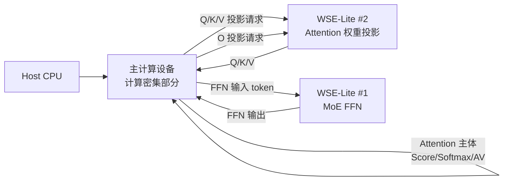

| 器件 | 承担 | 主要驻留数据 |
|---|---|---|
| 主计算设备 | Attention 主体、Norm、采样、调度与控制流 | KV Cache |
| WSE-Lite #1 | MoE FFN（含专家选择后的三个投影） | 专家权重 |
| WSE-Lite #2 | Attention 的 Q/K/V/O 投影 | 投影权重 |

两台 WSE-Lite 都是**协处理器**：不持有模型控制流，不决定执行顺序，只对 主计算设备 下发的请求做固定形状的响应。权重在模型加载时就已驻留在各核 local SRAM，稳态下不再重新下发。

### 1.4 这个划分带来的两个新问题

三分离把内存墙换成了另外两堵墙，它们决定了后文大部分设计：

- **器件间往返时延。** 按第 18 节部署，每层三次主计算设备 ↔ WSE 往返，这部分开销全落在 UB 组网与 Batcher 上（第 6 节）。
- **核间通信取代共享内存。** 没有跨核隐式共享内存，切分后的 tensor 只能靠 NoC 上的显式集合通信拼回来（第 16 节）。

---

## 第二部分 · 硬件架构

## 2. 硬件架构总览

WSE 硬件是四层：对外靠 UB 总线组网，对内靠 Batcher 分发，核间靠 NoC，核内靠每核自己的 local SRAM。不同核之间没有隐式共享的 payload 内存；同一核内部仍有 Shared Tile 和共享服务。

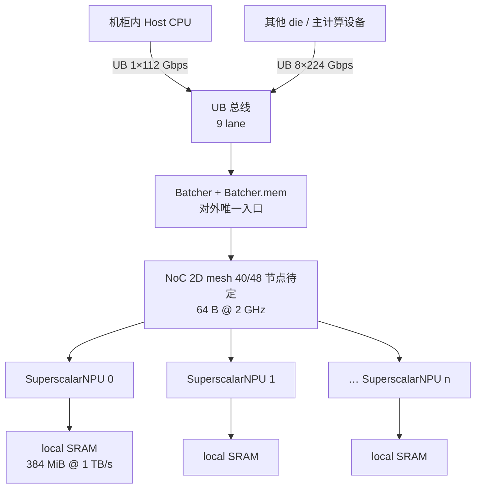

### 2.1 四个部件的职责边界

| 部件 | 职责 | 不承担什么 |
|---|---|---|
| **UB 总线** | 机柜内与 die 间互连；接 Host CPU 与主计算设备 | 不直接触及 SuperscalarNPU |
| **Batcher** | 外部 ↔ SuperscalarNPU 的唯一桥梁；输入数据、kernel 二进制下发；结果回写落点 | 不参与核间数据交换 |
| **NoC** | 核间 payload 搬运与集合通信 | 不承担对外 I/O；不存储路由表 |
| **SuperscalarNPU + local SRAM** | 计算与权重驻留 | local SRAM 不对其他核可见 |

两条结构性约束贯穿全文：

- **对外只有一个口。** 任何从片外进入 SuperscalarNPU 的字节必经 Batcher，SuperscalarNPU 的输出也必须回写 Batcher。指令与常量的 cache miss 回填也走这条路（第 4 节）。
- **跨核没有隐式共享内存。** 核 A 要拿到核 B 的数据，只能由核 B 主动从 NoC 发出去。

### 2.2 三个时钟域

| 边界 | 关系 | 后果 |
|---|---|---|
| Reticle 内 NoC | 同步，2 GHz | Calendar 时隙可以按 cycle 编排 |
| SuperscalarNPU ↔ NoC | **异步**（1.4 GHz ↔ 2 GHz） | 跨界需握手；核程序不感知 NoC cycle |
| Batcher ↔ SuperscalarNPU | **异步** | Batcher 下发与核执行不共享时间基准 |

这三道边界解释了 Calendar 方案为什么把对齐做成硬件内部的事：核程序只能表达"我到了"，无法表达"第几拍发"，发包时机必须由 NoC 侧的 `CalReg` 决定。

> **命名约定。** 本文的 UB 仅表示对外互连总线。旧核 Unified Buffer 的 384 KiB 数值保留为向量/通信工作集预算，不继续作为新核的软件地址空间名称。`local SRAM` 是归属本核的物理存储，`Local Tile` 是新核的 Tile 状态，两者不同。

## 3. SuperscalarNPU 核结构与 WSE 目标配置

### 3.1 从流水编号转向程序、Block 与 Tile 依赖

每个 SuperscalarNPU 核执行包含标量控制和 Tile 运算的程序。Thread 保有独立程序身份；SPE 完成取指、块控制、标量依赖管理与乱序执行，Tile 工作交给 VEC、CUBE 和 MEM 等执行域。TMU 管理 Tile 绑定、物理分配、就绪及生命周期。执行完成、结果发布、顺序提交和外部写入可见是不同事件。

| 组成 | 核内职责 | WSE 接口要求 |
|---|---|---|
| SMT | Thread 身份与线程服务 | 区分核节点号、Thread ID 与参与掩码 |
| SPE | IFU、BCTRL、OOO、IEX、DTU；标量程序和块顺序 | 形成控制/访存操作数，关联精确故障与恢复 |
| VEC | 向量与逐元素运算 | 消费已就绪 Tile，按结果协议写回 |
| CUBE | 矩阵运算 | 满足整核吞吐目标，使用明确的 Tile 输入输出 |
| TMU | Tile 绑定、重命名、存储与生命周期 | 对通信源做保留，对通信目的建立独占写入与就绪协议 |
| MEM | 标量、Tile 和索引访存；TLSU 属于 MEM | 连接 WSE 地址译码、local SRAM 和外部数据端口 |
| GPE | 核内 Group 协作 | 与跨核 Calendar 域分开，不直接充当 NoC 集合通信 |

上述是职责划分，不要求各域各有一份独立物理副本。SPE 的内层 ROB 管理标量顺序，BROB 管理 Block 顺序；不能再用“所有工作共用一个统一 ROB”的早期框图替代当前合同。

### 3.2 保留的整核吞吐目标

| 精度 | 整核等效 MAC/cycle | 目标算力 @1.4 GHz | 说明 |
|---|---:|---:|---|
| FP16 | 4096 | 11.4688 TFLOPS | 等效 16×16×16 |
| FP8 | 16384 | 45.8752 TFLOPS | 等效 16×32×32，WSE 目标 |
| FP4 | 32768 | 91.7504 TFLOPS | 等效 16×64×32，WSE 目标 |

Vector 保留整核 256 B/cycle 的目标；输出转换/写回路径也以原 256 B/cycle 为预算目标，但不再指定旧 FixPipe 指令或物理模块。内部采用多个 PE 时，以上目标均为聚合值。资料中的四 PE 参考组织可以作为实现候选；目前 Shared TMATMUL 合同还存在固定四 PE 的协作条件，改变 PE 数必须同步修改对应 ISA profile 和编译约束。

峰值比值不证明实际吞吐。发射、Tile 端口、Shared 数据供给、累加器和写回都必须供得上；FP8 的 WSE 4×目标尤其不能从其他参考配置自动继承。

### 3.3 保留容量，重新定义预算归属

| 原 WSE 容量 | 新核中的目标预算用途 | 尚需定稿的实现 |
|---|---|---|
| L0A 128 KiB | CUBE A 操作数暂存 | Tile backing、读缓冲与端口划分 |
| L0B 512 KiB | CUBE B/权重驻留 | Local/Shared 分工、bank 和供数路径 |
| L0C 256 KiB | 矩阵累加与结果暂存 | 累加状态和结果 Tile 的交接 |
| L1 1 MiB | 通用片上 Tile backing 预算 | Local/Shared 分区、分配和回收 |
| Unified Buffer 384 KiB | 向量/通信工作集预算 | arena、向量中间结果、双缓冲配额 |
| local SRAM 384 MiB | 每核权重与大张量 | 1 TB/s 的 WSE 目标端口；bank、读写端口与访问粒度待定 |

本版容量统一使用二进制单位：1 KiB=1024 B，1 MiB=1024² B；这是现有 WSE 模型 `analysis/platform.py` 对旧 KB/MB 数值的解释。带宽 GB/s、TB/s 使用十进制单位。

SRAM 不采用旧 DRAM 的行激活/物理页假设。2 KiB 若继续作为软件搬运块，必须在 Q8 中单独确定，不应被称为 SRAM 最小读写单位。384 MiB 的容量与 1 TB/s 的带宽均为待物理实现验证的目标。

前五项作为互不重叠的容量预算保留，总计 **2304 KiB（2.25 MiB）/核**。它们不等于已经确定的五块新核 SRAM。Local/Shared 是 Tile 作用域与访问契约，不是额外叠加的两份容量；同一 Tile 必须只计入一个 backing pool。384 MiB local SRAM 与上述 2.25 MiB 执行暂存预算分开计算，尚未合并物理存储池。缓存、队列、重命名表和控制存储未由此表覆盖，需单独预算。

### 3.4 Tile 状态和通信生命周期

Local Tile 的相对 hand、代际、大小与物理 Cell 地址分开管理，Shared Tile 也有自己的绑定与所有权。SSM NDF 的 Local Tile 采用 128 B Cell 粒度，当前核合同的单 Tile 范围为 128 B–32 KiB；这不是总寄存器存储容量，也不是 PTO ISA 所有实现的统一上限。

因此 48 KiB 接收 arena 不能直接假设可装入一个 Local Tile。本版选择 Shared backing 作为 router 接收的基线路径；较大 arena 可由多个合法 Shared 对象组成，并逐一绑定和跟踪覆盖，不能假定单对象容量无限。具体对象分段、预算和可选内存窗口列入 Q7，在确定前不把 `B.ASSEMBLE` 等同于任意 NoC 落点写入。

对通信源，TMU/适配器需锁定实际绑定的代际与物理位置，直到数据读出责任结束；对通信目的，只有范围完整、写入可见且去重计数满足时才能向依赖消费者发布就绪。旧物理槽被回收后的迟到响应必须被身份检查拒绝。

## 4. 存储层次与数据通路

### 4.1 三种含义不能混用

`GM` 是 ISA 的普通内存访问域；local SRAM 是 WSE 的物理存储；Local/Shared Tile 是核内数据对象。采用 SuperscalarNPU 不意味着自动恢复跨核全局 HBM，也不意味着删除新核所有 GM 访存指令。

本版提出 WSE 目标地址映射：本核权重/张量地址映射到本核 local SRAM，代码和常量映射到 Batcher 后的程序镜像，跨核 payload 仍经显式 Calendar 操作。具体虚拟地址布局、保护、缓存属性和故障编码列入 Q13。SSM 当前 NDF 中统一 GM、PTO-TSO 和多核一致性假设不能直接套在 WSE 上；局部映射必须在目标 ISA/profile 中明确，不能由模型静默改写内存语义。

### 4.2 代码、常量与 payload 的通路

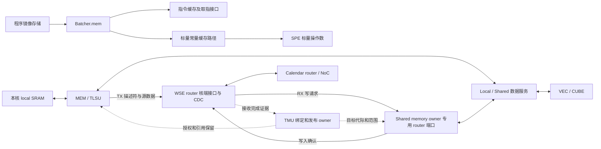

图中的接口是 WSE 对 SuperscalarNPU 的新增集成要求：**MEM.TLSU 增加 router 发送/控制接口，Shared memory owner 增加独立的 router 接收写入接口**。发送从 TLSU 取得合法源数据；接收经 Shared 存储仲裁落地。TMU 继续独占绑定、代际和发布/回收责任，router 不直接改 Tile ready 位。具体 RTL 信号和 ISA 编码尚待实现。

Batcher 的输入激活也通过受控数据端口落入目标 backing。端口需区分请求被接受、实际写入完成以及消费者可见，携带 Core/Thread/目标代际身份，并支持背压。NoC 入口、Batcher 入口与 MEM/TLSU 的写冲突必须由同一个存储 owner 仲裁。

### 4.3 标量静态表与缓存预算

Calendar 静态表继续放入只读程序镜像，通过标量 load 取得。编译期立即数属于 A 类；每次 launch 的参数属于 B 类；线程私有中间状态属于 C 类。`blockId` 在本版表示 **NoC 节点号**，不等于 Block 动态身份 BID，也不等于 Thread ID。

在 40 节点 Calendar 基线下保留 16 B 表项、64 B 对齐与目标 64 B cache line。key-major 布局下每节点访问 `keyCount` 条 cache line；node-major 下最多压缩至 `ceil(keyCount/4)` 条。这个计算描述地址工作集，不保证缓存没有冲突或驱逐。若每个 Thread 使用私有 D-cache，同一节点多个 Thread 重复读取会产生额外物理副本；可以由节点通信 owner 集中读取，但不得宣称天然只有一份。

指令回填原 2 KiB 粒度可作为 WSE 程序端口目标保留，不能等同于新核 I-cache 行大小。静态表不占 payload Tile backing，仍需占标量缓存和取数带宽。

### 4.4 带宽目标

| 通路 | WSE 目标 | 归属 |
|---|---|---|
| local SRAM | 1 TB/s/核 | 新核所有内部 PE 共享整核预算 |
| NoC 单链路 | 128 GB/s/方向 | 64 B × 2 GHz，未扣头部和空隙 |
| UB 总线组网 | 224 GB/s | 8 × 224 Gbps |
| UB 总线 Host 方向 | 14 GB/s | 1 × 112 Gbps |

1 TB/s ÷ 224 GB/s ≈ 4.46 是保留权重驻留策略的带宽动机；它不是整个 SoC 的吞吐倍数。MEM/TLSU 到 local SRAM 的实际有效带宽需扣除 bank 冲突、排队和共享端口损耗。

### 4.5 TLSU、Shared memory 与 router 的接口合同

一个 NoC 节点连接一个 SuperscalarNPU 核；节点内的多个 Thread 通过受控仲裁共享通信端点。下面是逻辑通道，独立逻辑责任不要求独立物理总线。所有通道都须跨 1.4 GHz 核域与 2 GHz router 域安全交接。

| 接口 | 方向与内容 | 接收方承担的责任 |
|---|---|---|
| TLSU router-command | TLSU → 适配器：本地事务 ID、Thread/Block/代际、opcode/epoch、源绑定、几何、routeBits、对称目的范围 | 原子接受完整描述符；容量不足时不形成半条事务；与普通 GM 请求区分 |
| TLSU router-data | TLSU → 适配器：源数据、字节使能、事务/segment/beat 身份、结束标志 | 源绑定已就绪且被引用保留；按规定字节数接收，不能读到被回收的新代际 |
| Shared router-write | 适配器 → Shared owner：接收上下文 token、目标代际、offset、有效字节、源/segment/beat 身份 | 检查范围与授权，仲裁 TLSU/Batcher/其他写端口，完成存储写入；router 不提交任意物理 Cell 地址 |
| Shared router-write-response | Shared owner → 适配器：相同身份、已写入范围、可见性确认或故障 | 只在确认的数据可供指定消费者观察时交付成功证据；队列接收不等于写入完成 |
| router-completion | 适配器 → TLSU/块管理、TMU：登记接受、源读出结束、发送排空、接收完成或故障 | 各事件独立保留、恰好交付一次；TMU 决定 Tile 发布，BROB 决定 Block 提交 |
| TMU reservation | TMU ↔ TLSU/适配器/Shared owner：绑定解析、目标写授权、引用保留和释放 | 在事务收束前保持对象有效；恢复后旧响应不得作用于复用槽位 |

ready/valid 仅表示一次通道交接：背压时 payload 与身份保持稳定，成功交接只记一次。若采用 credit 流控，则必须明确 credit 的资源单位，且仅在对应资源实际释放后归还。CDC 队列、完成通道和控制/故障通道不得等待“消费者已读 Tile”才能前进。

本地事务身份不自动加入线上 flit 头。线上如何承载或重建 source、segment、地址范围和 epoch 仍属 C-2/S-6/Q14；现有 12/14 B 开销只是已列头字段的基线，不能拿它代表新增身份信息已经免费传输。

### 4.6 接收资源、调度准入与正常完成

接收登记、报到及发送请求对外生效前均须满足 non-flush 资格。一次集合对齐前，节点必须保留源绑定和目标 Shared backing，建立接收上下文，并预留去重、写确认和完成反馈容量。接收上下文记录目标代际、合法写范围、预期来源/segment 集合和 expVal。多个写端口不得并发覆盖同一接收范围；不同不重叠范围可以按存储 owner 的仲裁规则并行。

**align 表达“本轮可按时收发”，不只表达“程序走到了这里”。** 每个成员提交 align 之前，接收登记必须已成功，发送描述符/数据 staging 或其有界供给服务也必须就绪。无法预留时在入网前停留；不能先占 router 队列再等待 TMU 分配目标。

有限 credit 只能防止溢出，不能独自证明 Calendar 时隙无冲突。正常调度需要对 Shared 写端口、TLSU 供数、CDC 和 RX 缓冲给出有界服务保证，并将最大等待和仲裁干扰计入 NoC 调度证明。Batcher 或后台 TLSU 不能无界抢占已预约的接收服务。若违约，停止本轮新注入并进入故障收束；未经重新调度和去重协议，不允许自行延后发送或重放到其他时隙。队列深度和带宽尚未确定前，不宣称端到端无死锁或无拥塞已经证明。

到包先检查身份并登记 pending segment，pending 副本也要抑制，不能等写确认后才去重。对拆成多个 beat 的 segment 保留字节覆盖，只有成功提交的唯一远端有效字节增加 expVal 计数；头部、填充、重传、自拷贝及失败写入均不计。相同身份却不同地址/长度的副本是故障。

当且仅当远端计数达到 expVal、远端与本地自拷贝共同覆盖目标、所有写入可见、Shared 参与/producer 义务满足且没有故障时，TMU 才发布对应代际。远端计数超额、范围重叠或不完整不能由“count >= expVal”掩盖。Shared memory 是存储端口，Shared Tile 是架构对象，两者通过 TMU 的合法绑定关联。

### 4.7 排空与故障收束

源数据被可靠复制到发送缓冲后，可以结束 TX 持有的源 Tile 读引用；本地自拷贝和其他消费者的读引用独立保留，全部引用收束后才能回收源对象。网络发送责任继续保留到真实 TX 排空。本版 `calendar_drain_send` 仅证明本地 TLSU/适配器 TX 工作已完成注入且无本地待发送数据，不证明网络已经排空，也不证明远端写入可见；后者由接收侧写确认和发布路径证明。

全片排空必须由所有节点完成状态汇合和网络在途责任检查证明，或采用另行验证的有界排空协议；具体控制通道/确认方式列入 Q14，不隐含假定已有 ACK 指令。多播节点同时承担转发和落核时的资源依赖也必须纳入网络证明。

launch 边界的全片排空同时要求 TLSU 发送、CDC、router、RX 待写、Shared 写确认、计量与完成反馈无在途责任，且 TMU 引用已正确收束。故障也必须保留已接受事务的状态，直到所有可能访问该代际的请求终结或被系统级复位隔离，之后才能回收 backing、复用 epoch 或安装新的 CalReg。停止注入不等于可以立即清空去重记录。故障后已写入的数据保持为未发布的失败代际，隔离于正常消费者；保留诊断或安全丢弃的策略由恢复 ABI 定义，不能自动套用 TLOAD 的故障部分结果语义。

## 5. NoC 架构

### 5.1 拓扑与带宽

| 项 | 取值 |
|---|---|
| 拓扑 | Calendar 基线 5×8；物理候选 6×8，Q1 待定 |
| 总线位宽 | 64 B |
| 时钟 | 2 GHz，Reticle 内同步 |
| 单链路单向带宽 | 128 GB/s |
| 对角最短路径 | 5×8 为 11 跳；6×8 为 12 跳；实际 multicast 树深另算 |

2D mesh 的代价在于**中心链路是天然热点**：多对多集合通信下，中间行列的链路要承载远多于边缘的流量。对带宽型负载，这意味着尾时延不可控。

### 5.2 为什么需要 Calendar

Calendar 将正常流量的发送时刻放到编译期规划；有限缓冲仍需要安全流控。相较主要依靠运行期仲裁的方案，它的收益以端口服务和时隙证明成立为前提：

| 动态仲裁 | Calendar |
|---|---|
| 拥塞时背压，尾时延长尾 | 编译期错峰，尾时延可预测 |
| 每跳查路由表，有状态 | 每跳无需路径查表，按 flit 头位图转发 |
| 无需全局时间基准 | 依赖 BSP 对齐与全域时隙表 |
| 任意流量模式 | 要求流量模式编译期可知 |

本方案要求集合形状和参与者在编译期确定，或经固定容量映射后满足同样条件；数据相关的 MoE 参与行为仍须解决 Q6。

### 5.3 NoC 在 Calendar 下的行为

NoC 只做两件事，两件都是**被动**的：

1. **路径：按 flit 头自带的位图转发。** 每个节点一个 `{P, L}` 位对：`P=1` 表示经过，`L=1` 表示落核。节点本地查自己的位对就能决定转发与落核，**无需任何路由表存储**。
2. **时机：按 `CalReg[opcode]` 放行。** 时隙表内容在装载期一次性写入各节点寄存器，kernel 期只读。

AllGather 的拆包与转发复制由网络承担；归约 merge 的类型与完成语义仍待 C-3/C-10 定义。

### 5.4 代价：flit 头开销

每个 flit 携带同一份头部：

| 字段 | 大小 |
|---|---|
| `routeBits` | 80 bit = 10 B |
| `opcode` + `redOp` | 6 bit |
| `epochTag` | 待定（建议 8–16 bit） |
| **合计** | **8 bit epoch 基线为 12 B（18.75%）；16 bit 时为 13 B（20.31%）** |

8 bit epoch 基线下的 18.75% 就是"NoC 每跳不保留路径上下文"的标价。替代方案（逐 packet 头 + 沿途保留上下文）能省带宽，但把状态还给了 NoC，尚未决断。

> **注。** 现有 Calendar 设计文档按 **40 个 NoC 节点（5×8）** 写就，`routeBits` 的 80 bit 宽度直接来自这个数字；本版同时保留 **6×8 = 48** 物理候选。两者需对齐（附录 Q1）；若为 48 节点，`routeBits` 为 96 bit；8 bit epoch 时头为 14 B，16 bit 时为 15 B。原 16 B 路由表项也无法容纳 12 B 位图加 6 B 尾字段，Q1 决定前不得发射该布局。

## 6. Batcher 与 UB 总线

### 6.1 Batcher：唯一的对外入口

Batcher 坐在 Host/主计算设备 与 SuperscalarNPU 阵列之间，是**外部世界进入芯片的唯一通道**。它同时承担四类职责：

| 职责 | 方向 | 频度 |
|---|---|---|
| 算子 kernel 二进制下发（`.text` + `.rodata` 同批） | 入 | 每 kernel 一次 |
| 权重下发到各核 local SRAM | 入 | 模型加载一次 |
| 输入激活分发给各 SuperscalarNPU | 入 | 每次推理 |
| 各核计算结果汇收回写 | 出 | 每次推理 |

**Batcher.mem 是一个双重角色的部件**：它既是数据面的暂存（输入分发、结果汇收），也是控制面的中转（每核 I-Cache / D-Cache 的 miss 回填都经它从程序镜像存储取）。后一个角色很容易被忽略，却直接决定了冷启动的代价：多核同时冷 miss 时，Batcher.mem 是共享的，代价不按核数线性展开。

### 6.2 分发模型对时延的意义

"所有输入经 Batcher 分发，所有输出回写 Batcher"意味着每次协处理调用都含一次扣不掉的固定开销：

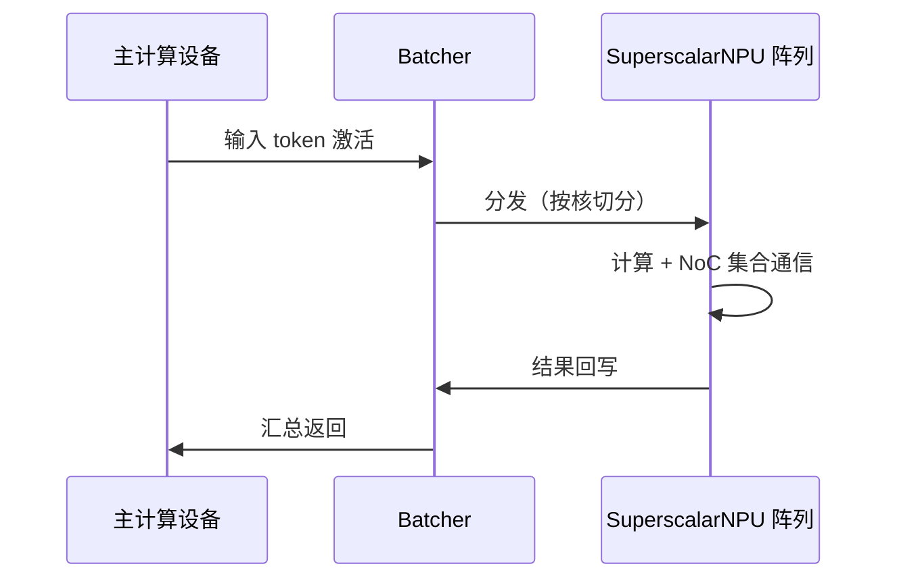

因此 WSE 适合的是**粒度足够大的整层算子**（整个 FFN、整组投影），而不是细粒度算子——后者的往返开销会吞掉全部收益。这也解释了三分离为什么按整层算子切分。

### 6.3 UB 总线

| lane 分配 | 速率 | 用途 |
|---|---|---|
| 8 lane | 8 × 224 Gbps = 224 GB/s | 组网互连（die 间 / 与主计算设备） |
| 1 lane | 1 × 112 Gbps = 14 GB/s | 机柜内 Host CPU |
| **合计** | **9 lane** | |

两条观察：

- **组网带宽（224 GB/s）远小于单核 local SRAM（1 TB/s）。** 器件间只能传激活，不能传权重——权重必须驻留。这是三分离部署可行的前提。
- **Host 通道（14 GB/s）是控制面尺度。** 它只能跑命令与小量元数据，不在推理关键路径上。

---

## 第三部分 · 软件架构

## 7. 软件栈总览

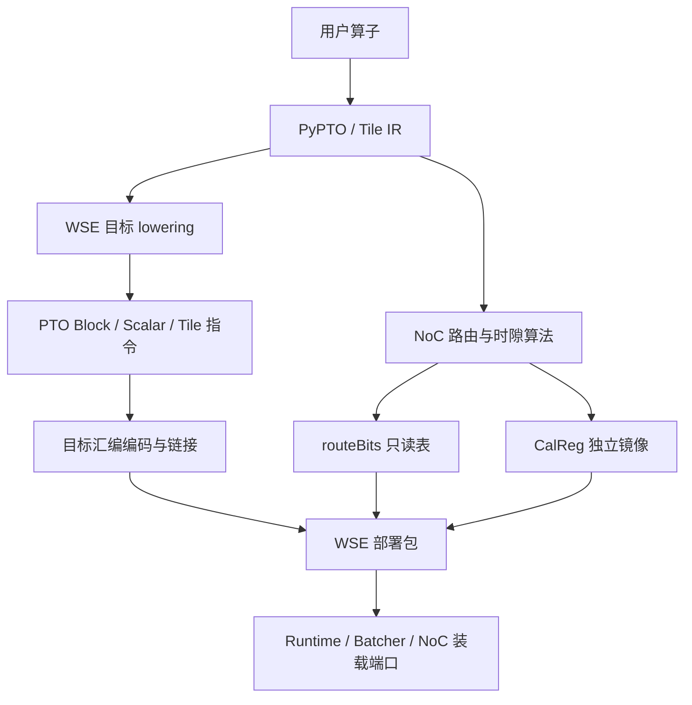

### 7.1 各层契约

PyPTO 表达计算与集合语义，WSE lowering 负责内存映射、Tile 绑定、Block 组织、核内 Thread 协作和 Calendar 依赖；目标工具链负责具体编码、重定位与链接。旧 CCE → Bisheng → 达芬奇机器码路线不再是本目标的编译链。

SSM 的指令登记表可以证明某些指令名与执行类别存在，不能证明 WSE backend、ABI 或完整编译器已经实现。最终二进制 ISA 版本与工具链 revision 必须锁定到部署包。

### 7.2 两份通信产物仍需同源

NoC 算法一次读取拓扑、参与组、载荷几何和并发关系，同时产出 `routeBits` 与 `CalReg`。前者与 `.text` 一同进入程序镜像，后者作为独立装载物写入 NoC。只验证版本相同不足以证明调度无冲突，仍需算法提供可核验的调度保证。

### 7.3 编译器必须看见的区别

核内 Group 协作与跨核 Calendar 集合使用不同参与者、不同进度和不同完成域。编译器必须同时识别这两层，不能把四 PE 的 Group 操作扩展成 40/48 个 NoC 节点的集合。

## 8. PyPTO 编程与目标映射

### 8.1 用户算子与核内执行

用户继续描述 Tile 计算和跨核集合。新核通过 Block 属性、Tile 输入输出绑定与就绪依赖组织执行，软件不再直接分配旧 `PIPE_MTE1..4` 或用旧 `set_flag` 规定新核内部流水。

框架可以保留自动切分和显式 Tile 调优两类入口，但显式配置必须落在新核合法的 Local/Shared 绑定、大小、布局和生命周期上，不能把旧 L0/UB 地址原样作为新核物理 Cell 地址。

### 8.2 核内与跨核通信

| 层次 | 数据移动 | 完成依据 |
|---|---|---|
| 核内 Tile/Group | 已定义的 Tile 操作与核内 Group 协作 | Tile/Group 的绑定、依赖、发布与提交合同 |
| 跨核 Calendar | WSE NoC 适配器，按 `routeBits` 与 `CalReg` 发送 | 本轮有效提交字节达到 `expVal`，并满足发送排空与可见性条件 |
| 非 Calendar 跨核路径 | 仅保留扩展需求 | FIFO、门铃和目标指令均需单独定义 |

旧文中的 `TPUSH/TPOP` 等框架名称不构成新核已有机器指令的证据。首期通信闭合目标为 AllGather；Reduce 系列仍受 C-3/C-10 限制，不因更换核而自动获得实现。

### 8.3 编译期责任

1. 识别核内 Thread/PE 协作和跨核参与组，并指定每节点的通信 owner。
2. 根据 WSE 目标配置分配 Tile/backing、双缓冲空间与通信生命周期。
3. 联合生成路由和时隙，检查同 opcode 集合之间的并发冲突。
4. 保留 64 B 对齐的 `.rodata` 表，固定 `keyId/opcode/expVal/capacity/selfOff`。
5. 检查路由树、落点覆盖、收发守恒与 40/48 节点布局边界。
6. 建立非投机资格、接收登记、发送、排空、完成与消费依赖。
7. 按第 9 节区分已有 ISA 和待定义 Calendar 扩展，再交给目标编码工具链。

路由表本身不占 Tile backing，但通信源、目的和工作 Tile 仍需要活跃区间、容量与端口预算。

## 9. 指令与接口更新

### 9.1 已有的新核指令基础

下列名称在本次查阅的 SSM 指令登记表或当前 NDF 中有依据；具体编码、操作数和合法组合仍以所锁定 PTO 版本为准。

| 作用 | 指令/状态基础 | WSE 中的使用 |
|---|---|---|
| Block 控制 | `BSTART`、`BSTOP` | 程序组织、动态 Block 身份与顺序提交 |
| Local Tile 绑定 | `B.IOT` | 输入绑定、目的大小和代际关联 |
| Shared Tile 绑定 | `B.IOS` | 核内 Shared 对象的使用 |
| 几何和属性 | `B.DIM`、`B.DIMI`、`B.DATR`、`B.FPATR` | 分离形状、布局与浮点属性；编码名见目标规范 |
| 视图与组装 | `B.SUBVIEW`、`B.ASSEMBLE` | 合法子范围与目的覆盖；不是任意 DMA 发布指令 |
| 内存与 Tile 搬运 | `TLOAD`、`TSTORE`、`TMOV` | 经过 WSE 内存映射与 Tile 合同 |
| 计算 | `TMATMUL`、`TADD` 等 | CUBE/VEC 执行与 Tile 依赖 |

这里的 Local/Shared 不是旧 `__ubuf__`/`__cbuf__` 的别名。普通标量 load 仍可读取路由表，但读取完成不代表 Calendar 发送已取得外部副作用资格。

### 9.2 Calendar 的语义接口提案

本次资料中没有得到可直接使用的 Calendar SEND/RECV 机器编码。以下名称均为**设计伪操作**，用于明确 lowering 和硬件接口，不是汇编助记符：

| 伪操作 | 必需输入 | 成功/故障边界 |
|---|---|---|
| `calendar_align` | 节点参与组、opcode、集合 epoch、launch 身份和本轮资源准入状态 | 所有成员接收登记及有界收发服务已就绪后才对齐放行；不能拿核内 barrier 替代 |
| `calendar_post_receive` | 接收对象/代际、范围、capacity、expVal、opcode、epoch | 在 align 前登记并预留接收资源；登记独立完成，数据完成异步报告 |
| `calendar_send` | 源 Tile 绑定、几何、对称目的范围、routeBits、opcode、epoch | 非投机且资源可接受后交接，源数据保留至读出责任结束 |
| `calendar_drain_send` | 本轮发送身份 | 本地 TLSU/适配器 TX 已完成注入；全网排空另按第 4.7 节判断 |
| `calendar_await_receive` | 接收令牌/代际 | 有效 payload 已写入可见范围并达到 expVal；失败不会发布成功结果 |

接收上下文还需保存来源与 segment identity 用于去重，区分已提交 payload、重复包、自拷贝和旧 epoch。`launch` 身份可以由严格排空隔离，也可以由显式标签实现；后一种方案不能未经决议扩充当前 flit 头。具体 opcode 分配、操作数字段、异常码、token 编码和端口协议列入 Q14。

### 9.3 与旧核接口的替换关系

| 旧核接口 | 新核设计要求 |
|---|---|
| CCE/Bisheng 内核目标 | WSE 目标 lowering 与 SuperscalarNPU 指令编码/ABI |
| `LOAD2D / MAD / FIXPIPE` 展开 | Tile 搬运、矩阵操作、结果转换及发布，按目标 ISA 定义 |
| `MTE3_NOC_SEND` | `calendar_send` 提案，由 WSE NoC 适配器承担外部发送 |
| `MTE4_NOC_RECV_WAIT` | 拆成接收登记与最终等待，保护后续发送的推进能力 |
| `SET_CROSS_CORE` | 跨节点 align 提案，参与者是 NoC 节点而不是核内 Thread |
| `TSYNC / pipe_barrier / RecordEvent` | 区分 Tile 数据就绪、外部发送排空、接收可见和 Block 提交 |

旧方案“控制面新增 0 条、数据面新增 2 条”的结论失效；需要在 PTO 所属仓库确定新的 ISA/ABI 绑定后才能重新计数。

### 9.4 推测、退休与背压

Calendar 请求可以在核内准备操作数，但错误路径不能向 NoC 发送、改变接收上下文或参加不可撤销的跨节点汇合。发出外部副作用前，必须满足对应 Block/Thread 的 non-flush 条件和外部顺序约束；这不等于把所有指令都强制串行到 ROB 头。

接收登记的完成与集合数据的完成必须分离。否则较早的接收等待会挡住较年轻发送的 non-flush/提交资格，即使收发物理队列独立也会死锁。适配器必须保留发送进展所需的队列、资源与提交路径，具体深度在 Q14 中确定。

所有响应保留请求身份和代际；恢复后迟到响应不能写入新分配对象。已发生的跨核写入不得当作可随分支回滚的本地推测结果。故障时停止新的正常发布，并按系统错误与排空协议处理在途事务。

## 10. 编译产物与部署契约

### 10.1 产物

部署包包含目标 `.text`、只读 `routeBits` 表、独立 `CalReg` 镜像、版本/profile 元数据和每核权重分片。编译器必须在声明中记录核内 Thread 配置、每节点通信 owner、目标内存映射和 Calendar ABI 版本。当前仓库的 manifest 校验器只表达部分检查，不等于已有完整 WSE 编译器。

### 10.2 自检

F1/F2/F3 继续适用：Calendar 运行状态不得误放入共享静态变量；编译期 key 引用不得被意外物化；路由表保持只读、尺寸正确且至少 64 B 对齐。另需检查：

- 二进制采用声明的新核 ISA/profile，不能混入旧核 MTE/CCE 编码。
- `keyId/opcode` 与路由表绑定一致，静态字段按已确定 ABI 编码。
- 接收登记不会堵住发送的非投机资格；外部副作用与恢复合同相容。
- Tile 分配、arena 覆盖、发布、回收和容量检查闭合。
- 指令、静态表、时隙镜像与权重的目的内存窗口合法。

### 10.3 版本校验

保留 `topologyVersion/calendarVersion/routeVersion` 三版本检查。更换核后，还需校验部署包声明的 ISA/profile 和 Calendar ABI；字段格式未定，不能把它们伪装成现有三版本之一。任何不匹配必须在执行前失败，重新装载或失败校验后不能复用旧的“已验证”资格。

## 11. Calendar 通信编排

Calendar 是为 WSE NoC 设计的通信优化方案：**把"走哪里"和"何时发"两类信息都挪到编译期，运行期 NoC 只做被动执行。**

### 11.1 两类信息、两条载体

下表与第 11.5 节的寄存器对、缓存工作集计算均限于 40 节点基线；48 节点需先解决 Q1 的表项布局，不能沿用两条 load 和每行四项的结论。

| | **路由信息** | **时隙信息** |
|---|---|---|
| 形式 | `routeBits`：每节点一个 `{P,L}` 位对 | `CalReg[opcode]`：NoC 节点常驻寄存器 |
| 大小 | 40 节点 → 80 bit | 内部格式由 NoC 定义 |
| 存哪里 | `.rodata` 静态表，D-Cache 取用 | NoC 节点寄存器 |
| 什么时候写 | 随二进制下发，模型加载一次 | 装载期原子写入，kernel 期只读 |
| 核内表现 | 两条普通标量 64 bit LD | **一个 3 bit 编译期立即数 `opcode`** |

从核的角度看，时隙信息就是**对 NoC 节点寄存器的一次索引** `CalReg[opcode]`——程序不感知寄存器内部格式，也不感知 cycle。

### 11.2 `routeBits` 的语义

每个节点一个位对，四种取值：

| 位对 | 含义 |
|---|---|
| `00` | 无关 |
| `10` | 经过不落核 |
| `11` | 经过且落核（可续转） |
| `01` | **非法** |

NoC 节点只看自己的位对：`L=1` 落核提交；转发集 = 【`P=1` 的邻居】减【入口】。因此**每跳无需路径查表或每包路由上下文**；CalReg、流控与接收计量仍有状态。

编译期必须校验：`{P=1}` 的诱导子图连通、含 source、**无环（是树）**。否则包会在 mesh 上无限繁殖。

### 11.3 一轮集合的七个步骤

本版将旧核“对齐后登记接收”改成**登记并准入后对齐**，防止乱序核与 Shared 端口的不确定等待突破 arm-lead 假设。下列伪操作不是新指令编码，旧模型 Step0–Step6 仍待迁移。

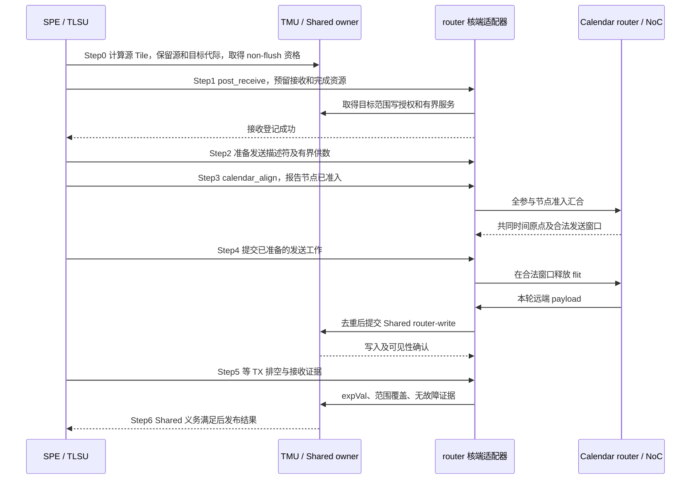

Step4 的本地提交必须包含在调度证明的有界 arm-lead 预算内；也可提前将描述符锁存在适配器，由 Step3 的释放事件启动，但对齐前不能注入 NoC。普通乱序执行不能提供一个未经证明的固定时间上界。

epoch 在接收登记和发送描述符中一致绑定，登记后到本轮收束前不能复用。节点内各 Thread 的计算就绪先汇总到一个通信 owner；每个 NoC 节点只对本轮报到一次。等待接收证据仅阻塞依赖消费者，不能占住后续发送必需的资源或 non-flush 条件。

### 11.4 排序与参与不变式

| # | 不变式 | 破坏后果 |
|---|---|---|
| **O1** | **路由与时隙同源**：同一次发包的 `routeBits` 与 `opcode` 必须来自同一逻辑身份 | 包沿正确路径走、按错误时隙放行 ⇒ 计划外冲突，**编译期查不出来** |
| **O2** | **对齐先于发送**：Step3 完成后才允许本轮发送进入 NoC | 错峰失效 ⇒ 链路冲突（**不是**静默错转发） |
| **O3** | **接收登记和资源准入先于对齐，最终等待不能阻断发送推进** | 丢失早到数据的计量，或全组死锁 |
| **O4** | **`routeBits` 就绪先于首包** | 用到未定义路由位图 |
| **E1** | **分支参与一致**：同 `opcode` 域内成员核调用次数与顺序逐次一致 | `epochCtr` 错位 ⇒ 按错 epoch 丢包 |

**O1 是本方案的主要新增风险。** 缓解手段是把一致性上移到类型系统：`keyId` 与 `opcode` 由同一逻辑身份一次解析出来，封装成不可拆分的编译期常量对 `CalendarKeyRef`，调用点不得分别传入。

### 11.5 代价模型：die 级一份拷贝

静态表按**全部节点**发射，不做 per-core 裁剪，全片镜像逐字节相同。代价分两块，量级完全不同：

| | 占用 | 量级（`keyCount`=2、40 节点） |
|---|---|---|
| 程序镜像存储 | `keyCount × 节点数 × 16 B` | 1 280 B，**die 级一份** |
| 单个节点通信 owner 的标量缓存工作集 | `keyCount` 条目标 64 B 行 | **128 B**，私有缓存副本另计 |

并且 D-Cache 占用可以再降四倍：把表转置成 node-major 后，本核的 `keyCount` 个表项连续，占 `⌈keyCount/4⌉` 条行。指令数、寻址形态、表总字节数全不变（待决项 C-9）。

## 12. Runtime 与调度

Runtime 负责把编译产物变成芯片上的状态，并在每次推理时驱动 Batcher。它的工作分**三个频度档位**，混淆这三档是性能问题的常见根源。

| 档位 | 做什么 | 频度 |
|---|---|---|
| **装载期** | kernel 二进制下发；权重写入各核 local SRAM；`CalReg` 全域镜像原子写入；三版本号校验 | 模型加载一次 |
| **每次 launch** | task descriptor；args buffer（含 `blockId`）；输入张量；相边界 barrier | 每算子一次 |
| **运行期** | 不插手 | — |

### 12.1 三类下发物的去向

| 下发物 | 经过 | 落到哪一级 | 频度 |
|---|---|---|---|
| kernel 二进制（`.text`+`.rodata`） | Batcher | 程序镜像代码段/数据段，**miss 时经 Batcher.mem 到 I$/D$** | 每 kernel 一次 |
| 模型权重 | Batcher | **各核 local SRAM** | 模型加载一次 |
| `CalReg` 时隙表 | 不经 Batcher.mem | **NoC 节点寄存器** | 一次性 |
| 输入激活 | Batcher | 各核通信/激活 backing | 每次推理 |

这张表是本系统最容易记错的一张。三个常见误解："路由表占 Tile backing"（不占，走标量常量路径）、"指令要过 local SRAM"（不过）、"时隙表每轮下发"（不是，一次性）。

### 12.2 冷启动与稳态

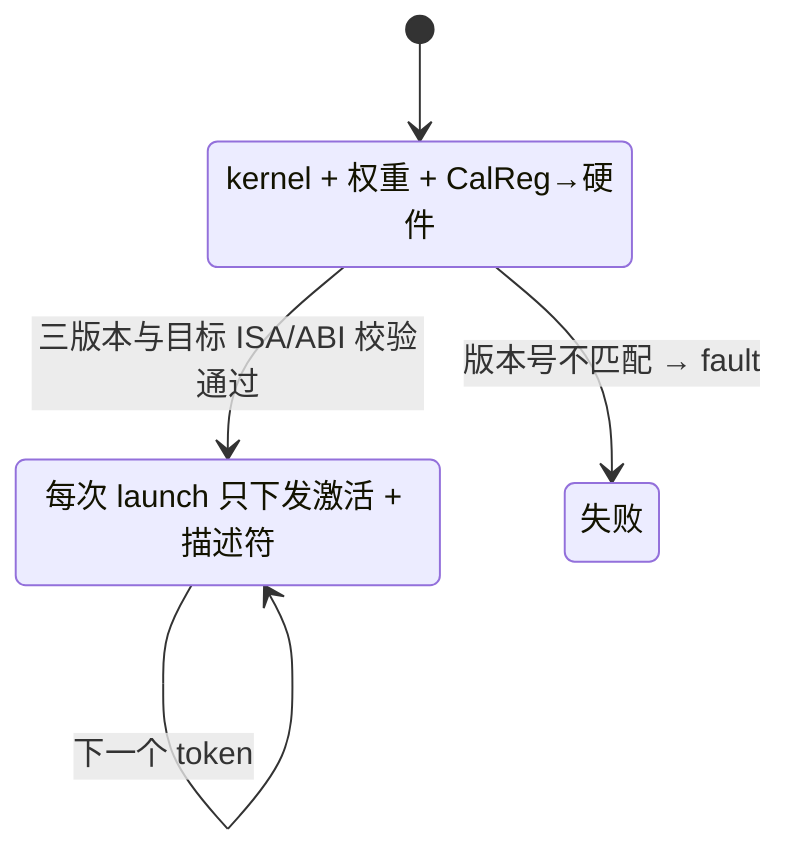

稳态下每次 launch 下发激活与必要的启动描述符，**不重新下发 Calendar 静态表与时隙镜像**。这正是把路由信息从 B 类推到 A 类的收益（第 4.2 节）。

### 12.3 调度约束

Runtime 必须兑现四条约束，否则集合通信会错：

1. **按完整 group 调度。** 分 wave 时不得拆开正在同步的组。
2. **相边界插 barrier。** 保证 launch 之间全片 Calendar 流量排空——跨 launch 的 epoch 隔离完全依赖这一条。
3. **`CalReg` 写入必须在停机窗口内。** 写入期间不得有 Calendar 流量在飞。
4. **提供 NoC 节点身份 `blockId`。** 通过目标 ABI 的只读系统身份或 launch 参数提供；当前不宣称新核存在旧 `block_idx` SPR。Thread ID 单独提供。

同时 Runtime **不做**两件事：不预建 `collectionEpoch`，不分配 notify counter。每轮 epoch 由核内计数器给出，Host 看不到 kernel 内的轮次。

---

## 第四部分 · 端到端执行流程

## 13. 编译期：从 Python 到二进制包

本部分把前面的静态架构串成一条时间线。三个阶段的分界标志很清楚：**编译期**结束于二进制包生成，**加载期**结束于三版本与目标 ISA/ABI 校验通过，**运行期**从 kickstart 开始——过了 kickstart，Host 就再也插不上手。

### 13.1 时间线

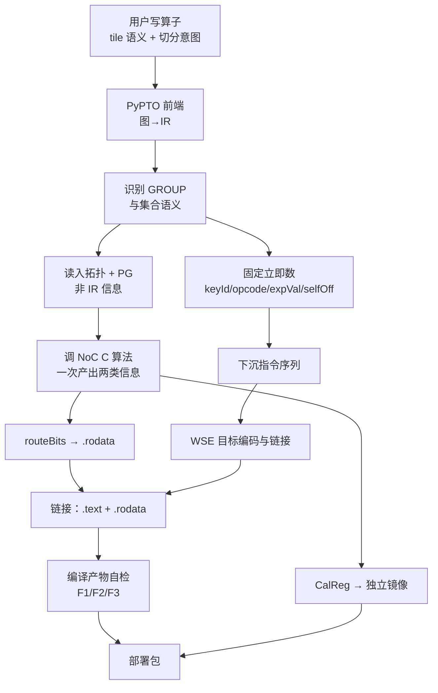

### 13.2 关键一步：一次算法调用产出两类信息

路径与时隙必须在**同一次** NoC 算法调用中生成，不能分两次。原因：共用同一 `opcode` 的全部逻辑身份必须相互无冲突，而"无冲突"只有在算法同时看到它们时才能保证。算法返回 `conflictProof` 作为凭据。

算法的输入里有一项容易被漏掉：**集合间并发关系**。它不在 IR 里，需要 PyPTO 从调度计划推出并传给算法；算法据此保证同 `opcode` 的两个集合不会同时在飞、也不会同时汇合。不满足则重新分相。

### 13.3 产物清单

| 产物 | 形式 | 去向 |
|---|---|---|
| kernel 机器码 | `.text` | 程序镜像代码段 |
| `routeBits` 静态表 | `.rodata`，64 B 对齐 | 程序镜像数据段 |
| `CalReg` 全域镜像 | 独立二进制段 | NoC 节点寄存器 |
| 三版本号 + ISA/profile/Calendar ABI 标识 | 元数据（新增格式待定） | 装载期校验 |
| 模型权重 | 按核切好的分片 | 各核 local SRAM |

## 14. 加载期：三条下发链路

加载期把三类东西放到位。它们走**三条不同的路**，落在**三个不同的存储层级**：

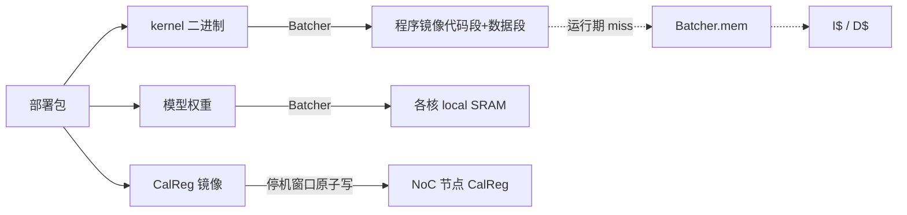

### 14.1 三条链路对照

| | kernel 二进制 | 模型权重 | `CalReg` |
|---|---|---|---|
| 经 Batcher | 是 | 是 | **否**（直达 NoC 节点） |
| 终点 | 程序镜像存储，运行期回填 I$/D$ | 各核 local SRAM | NoC 节点寄存器 |
| 经 local SRAM | **否** | — | 否 |
| 占 Tile backing | **否** | 装载到 local SRAM，执行时再取入 Tile | 否 |
| 写入要求 | 无特殊要求 | 按待定义 SRAM 事务/传输块对齐；不沿用 DRAM 物理页要求 | **停机窗口内原子写，不得有流量在飞** |

第三列的特殊性值得强调：`CalReg` 是唯一**不经 Batcher** 的下发物，因为它的目的地是 NoC 而不是 SuperscalarNPU。

### 14.2 装载期校验

校验通过才能进稳态。失败必须 fault，不得降级运行：

- `topologyVersion` / `calendarVersion` / `routeVersion` 三方匹配，同时核对新核 ISA/profile 和 Calendar ABI
- 目标芯片物理拓扑与编译期假设一致（无坏核/坏链重映射）
- `selfOff` 铺满性；各核行覆盖完整；`expectedRxBytes == expVal`
- 对称地址、容量、`opcode` 合法；`blockId` 在范围内

### 14.3 kickstart

kickstart 按新核启动 ABI 建立各 Thread 的入口、栈和参与状态，完成必要的程序/数据可见性维护，再允许执行。具体启动指令和寄存器由 Q15 定稿，不能沿用旧核单 PC 的隐含初始化。它不重新搬运权重或路由表。

## 15. 运行期：一次 decode step

这是全文的汇合点。以 WSE-Lite #1（MoE FFN）为例，一个 token 经过的完整路径：

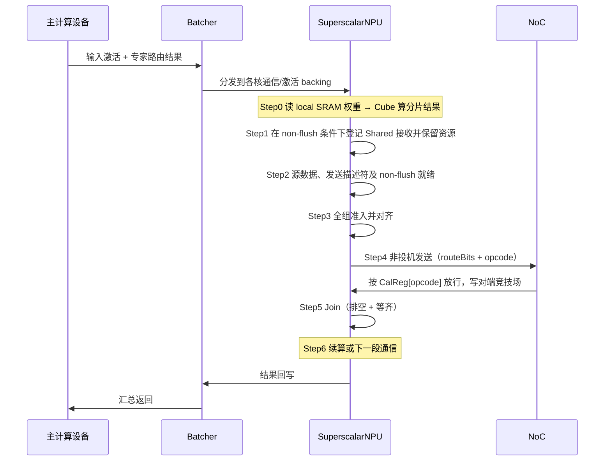

### 15.1 时间花在哪里

把一次调用拆成四段，四段的优化手段完全不同：

| 段 | 主导因素 | 怎么压 |
|---|---|---|
| 器件间往返 | UB 总线 + Batcher 分发 | 加大算子粒度，减少往返次数 |
| 核内计算 | 有效计算吞吐、Tile 供数与 local SRAM 带宽 | 形状利用率、精度与 SRAM bank/传输块布局 |
| 核间通信 | NoC 链路 + 对齐开销 | Calendar 错峰；切分选通信量小的轴 |
| 尾部同步 | 最慢核 | 负载均衡；避免专家倾斜 |

### 15.2 两个异步边界怎么跨

第 2.2 节的两道异步边界在运行期具体化为：

- **Batcher ↔ SuperscalarNPU。** 分发与核执行不共享时间基准，核靠数据就绪信号开工，而不是靠约定时刻。
- **SuperscalarNPU ↔ NoC。** 核通过 Step3 报告“本轮资源已准入且可按时收发”，无法表达"第几拍发"。发包时机由 NoC 侧 `CalReg` 决定，BSP 在硬件内部对齐全组时间原点，**不返回给程序**。

接收登记和容量准入在对齐前完成。对齐后的 **arm lead time** 只覆盖已准入发送的剩余有界准备；TLSU/Shared/router 的服务上界必须进入调度证明，不能包含无限等待分配或不确定的程序推进。

### 15.3 完成判定

收侧不用等通知，而是**数字节**：

```text
expVal（AllGather，不含本地自拷贝）
  = rowCount × rowBytes × (memberCount − 1)
```

只有**已提交到目标接收范围的有效 payload** 才计数；包头、填充、重传、本地自拷贝都不计。这把"集合完成"从一个分布式协议问题降成了一个本地计数器问题。

代价是硬件必须有**去重机制**：多播分叉的副本要按落核点去重，否则 `expVal` 会被重复计数提前满足，集合提前返回。这是待决项 S-6。

## 16. 核间集合通信

没有跨核隐式共享内存，"把切分的 tensor 拼回来"就不再是一次内存读写，而是一次显式集合通信。这是 WSE 编程模型与传统 NPU 最大的差别。

### 16.1 对称地址模型

发包指令的目的操作数不是"对端的物理地址"，而是**全组一致的对称地址 + 本核段偏移**：

```text
dstSymOff = recvSymBase + selfOff + r × recvRowStride
```

三条性质：

- 每个成员核的接收竞技场布局相同，`recvSymBase` 全组一致
- `selfOff` 区分"谁写哪一段"，编译期确定，必须不重叠地铺满每一行
- **转发不改变落点**：包沿路经过多少节点，写到哪里都由这个公式决定

### 16.2 AllGather 的执行形态

以行组 8 路 AllGather 为例：

1. 每个成员持有自己那一段 `sendTile`
2. 各节点先登记接收并准备发送资源，再于 Step3 完成全组准入对齐
3. 每个成员向组内其他成员广播自己那一段，路径由自己那行 `routeBits` 决定（一棵以自己为根的树）
4. 每个成员的竞技场被 `memberCount` 段铺满
5. 适配器取得唯一远端写确认达到 `expVal`，TMU 再检查本地段覆盖与 Shared 共同条件后发布

fabric 若不支持 self-delivery，本核那一段由合法 Tile 搬运或 backing 写入补齐，**不计入 `expVal`**。本地段也必须满足覆盖与可见性要求，不能只补一个计数。

### 16.3 归约类语义

归约在中间节点完成：位对为 `11` 且存在下游 `P` 邻居的节点是**归约点**，在此 merge 后续转。flit 头的 `redOp` 字段（3 bit）给出算子（`None/Sum/Max/Min/Prod`）。

这里有一个**必须在 flit 头格式冻结前解决**的缺口：`redOp` 单独不足以确定机器运算，还需要元素类型（建议 3 bit，取 `vtype_t` 子集）。首期只上 `AllGather` 时不阻塞，但不能忽略（待决项 C-3）。

### 16.4 与计算重叠

新核可让无依赖的 VEC/CUBE 工作与通信并行，但可重叠程度受 Tile 容量、端口、外部副作用资格和适配器资源限制。一个候选调度是第 i 分片 AllGather 期间计算第 i+1 分片；两者必须使用独立的目的代际和合法双缓冲配额。

等待接收不得阻断生成发送所需的标量、Tile 或提交路径；发送完成必须意味着实际满足排空条件，而不是仅进入队列。消费接收结果前还需完成本地自拷贝和所有远端写入可见性。这些条件由第 9.4 节的依赖与恢复协议实现，不以旧 PIPE 编号推断。

---

## 第五部分 · 业务映射与性能

## 17. 业务映射：MoE FFN

以 DeepSeek-V4 Pro 的 MoE FFN 为例。一个专家的 FFN 是三个矩阵：`W_gate`、`W_up`（都是 `[H, I]`）与 `W_down`（`[I, H]`）。

### 17.1 为什么切 N 轴

切分轴的选择直接决定通信量，而第 4.4 节已经说明 NoC 单链路（128 GB/s）比 local SRAM（1 TB/s）窄一个量级：

| 切法 | 每核持有 | 需要的通信 | 通信量 |
|---|---|---|---|
| **切 N（输出轴）** | `W[:, n_i]` 全列 | 算完拼接 → **AllGather** | 激活级，小 |
| 切 K（归约轴） | `W[k_i, :]` 全行 | 算完求和 → AllReduce | 激活级，但多一轮归约 |
| 不切，按专家分核 | 整个专家 | 无 | 0，但负载随路由倾斜 |

切 N 轴的代价是一次 AllGather，量级是**激活**而不是权重——这正是 NoC 能承受的。切 K 轴通信量相近但多一道归约，且归约语义首期未完全定义（待决项 C-10）。

### 17.2 两段式 AllGather

若参与核排成二维 mesh，直接做全连接 AllGather 会把中心链路撞满。分两相可以把流量限制在行列内：


两相使用不同 `keyId`（0 和 1），共享 AllGather 的 `opcode=1`，必须顺序执行并推进同一 opcode 域的 epoch。`keyCount=2`，每个通信 owner 的缓存工作集为 2 条目标 64 B 行，node-major 下为 1 条；多线程缓存副本另计。

### 17.3 容量约束

单核 local SRAM 384 MiB 是硬上限。以 FP8 权重估算，单个专家的三个矩阵共 `3 × H × I` 字节；根据 `H`、`I` 与专家数，可以直接算出一个核能驻留几个专家、需要几个核才能装下整层。具体模型尺寸尚未提供（附录 Q5），因此本节不给具体数字。

### 17.4 一个真正的难点：负载倾斜

MoE 的路由是数据相关的，每个 token 激活哪几个专家运行期才知道。这与 Calendar 的前提存在张力：

| | Calendar 需要 | MoE 路由的现实 |
|---|---|---|
| 通信形状 | 编译期确定 | 专家选择运行期确定 |
| 参与成员 | 固定 group | 每轮可能不同 |
| 调用次数 | 同 `opcode` 域内逐次一致（不变式 **E1**） | 核可能本轮无活可干 |

不变式 E1 要求成员核**不得有条件地跳过某一轮**。因此切分必须让所有参与核无条件参与每一轮集合（即使本轮发零），而不能按"本核本轮有没有专家被激活"决定是否调用。**这是 FFN 映射方案里最容易出错的一点**，具体策略需要确认（附录 Q6）。

## 18. 业务映射：Attention 权重投影

WSE-Lite #2 只承担 Attention 的**前后投影**，不碰主体计算。这条分界看上去奇怪，实际上它把一个算子沿着 roofline 性质切开了。

### 18.1 为什么只拿投影

| | 前/后投影（Q/K/V/O） | Attention 主体（QKᵀ/Softmax/AV） |
|---|---|---|
| 读什么 | **权重矩阵**，尺寸固定 | **KV Cache**，尺寸随序列长度增长 |
| 计算强度 | 理想值为 2×batch/每元素字节数 | 取决于 KV 长度与 batch |
| 驻留可行性 | **可以**，权重不变 | 不行，KV 每步追写 |
| 适合 WSE | 是 | 否 |

关键在第三行：WSE 的模型是"权重驻留、激活流动"。KV Cache 每步都在长，不符合驻留模型，放在 主计算设备 侧才合理。

### 18.2 一层的协同时序

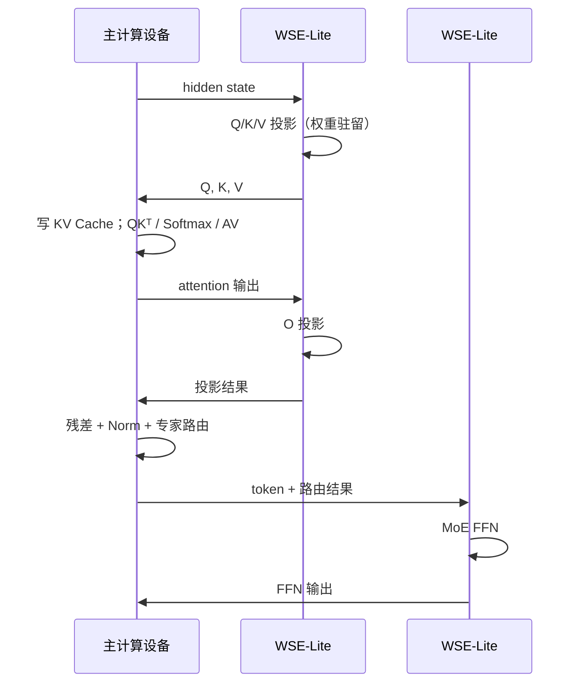

每层共 **3 次器件间往返**（2 次到 #2，1 次到 #1）。这是三分离的固定成本，不可消除，只能靠两个手段摊薄：

1. **流水化。** 层 `i` 的 FFN 与层 `i+1` 的 Q/K/V 投影分属不同器件，可以重叠。
2. **批量合并。** 多个请求的同一层投影合成一次调用，把往返开销分摊到更大 batch 上——这也是 Batcher 名字的含义。

### 18.3 切分与通信

Q/K/V 投影天然按 head 切分，head 之间无依赖，因此：

- 按 head 分核 ⇒ 每核算出完整的若干个 head，**无需核间通信**
- 单个 head 太大装不下时才切 N 轴，退回与 FFN 相同的 AllGather 形态

O 投影则相反：它的输入是所有 head 拼接后的结果，天然是沿 `K` 轴分布的，因此需要一次 **AllReduce** 或先 AllGather 再算。具体选哪种取决于归约语义的可用性（待决项 C-10）。

## 19. 关键设计权衡与性能分析

### 19.1 时延预算拆解

一次 WSE 协处理调用的时延分五块。每块的负责人不同：

| 块 | 受什么限制 | 弹性 |
|---|---|---|
| 器件间传输 | UB 总线 224 GB/s | 只能靠增大粒度摊薄 |
| Batcher 分发/汇收 | Batcher.mem + 异步边界 | 流水化可部分隐藏 |
| 核内计算 | CUBE/VEC 有效吞吐、local SRAM 及 Tile 供数 | 精度、形状利用率和流水重叠 |
| 核间通信 | NoC 128 GB/s/链路 + 对齐 | 切分选择；Calendar 错峰 |
| 尾部同步 | 最慢核 | 负载均衡 |

### 19.2 带宽与算力配比

保留峰值目标时，平衡点仍为 11.4688 / 45.8752 / 91.7504 FLOP/Byte。采用实际权重元素大小 b（FP16=2 B、FP8=1 B、FP4=0.5 B），理想 GEMV 权重计算强度为 `2×batch/b`。满阵列、只计权重流量时：

| 精度 | 满利用率的理论 batch 阈值 | 解释 |
|---|---:|---|
| FP16 | ceil(11.4688×2/2) = 12 | 真实权重字节数口径 |
| FP8 | ceil(45.8752×1/2) = 23 | 同上 |
| FP4 | ceil(91.7504×0.5/2) = 23 | packed 权重，不含额外格式开销 |

v0.1 的 6/23/46 使用与精度无关的 `2×batch` 近似，保留在旧模型 golden vectors 和 decision 0006 中作为历史口径，不能继续当作本版新核的物理阈值。本次没有修改这些测试或模型结果。

实际形状应比较 `compute_time` 与 `fetched_weight_bytes / effective_bandwidth`，其中计算时间需包含 PE/阵列填充、Tile 端口和写回瓶颈。16³ 是本版的等效吞吐预算，不能据此断言新核 batch=1 必然有 1/16 的行利用率。低精度也不能直接推出端到端 2×/4×加速。

端到端时延仍缺 Batcher 规格、设备往返、核内适配端口以及目标算子尺寸；本版不输出未经验证的总时延。

### 19.3 Calendar 的收益与成本

| 项 | 收益 | 成本 |
|---|---|---|
| 每跳无路径查表 | NoC 节点简化，无查表延迟 | flit 头 ≈ 12 B，占链路 **19%** |
| 时隙错峰 | 在调度证明和端口时序约束成立时控制冲突与尾时延 | 要求流量模式编译期可知 |
| 路由表进 `.rodata` | 每个通信 owner 的工作集为 `keyCount` 条目标 cache line；**每次 launch 零下发** | 依赖拓扑同构；坏核需降级路径 |
| 完成靠字节计量 | 接收完成不依赖 notify 计数；align 仍需独立参与状态 | 需硬件去重；需跨 launch 排空 |
| 核接口迁移 | Block/Tile 依赖与通信统一编排 | Calendar ISA/ABI 和非投机接口需重新定义 |

### 19.4 三个软件侧无法检测的死角

这三项如果硬件不兑现，软件**无法发现**，也无法兼容：

| 编号 | 依赖 | 不满足时 |
|---|---|---|
| **HW-5** | 接收上下文异步累计匹配且已提交的字节；登记独立完成，最终等待同时检查计数、覆盖与可见性 | 本方案最主要的正确性风险 |
| **HW-7** | 按 NoC 节点计数的参与汇合能覆盖完整参与组 | 计数或身份混淆 ⇒ 未到齐就放行 |
| **SW-1** | launch 边界前全片 Calendar 流量已排空 | 上一 launch 的滞留副本被误计入 |

HW-7 的计数若采用整数形式，表示 0..48 至少需要 6 bit；也可采用节点位图。旧核“现有 4 bit”不能作为新核事实。核内四 PE 的报到不等于四个 NoC 节点，具体跨节点硬件由 Q14 定稿。

---

## 附录

## 附录 A：待确认信息清单

以下均为 **WSE 系统专有**、且无法从现有资料推出的信息。本文在相应位置标了假设或留白，**没有构造数字**。按阻塞程度排序。

### A.1 阻塞级（不确认则相关章节无法定稿）

| # | 问题 | 影响章节 |
|---|---|---|
| **Q1** | **NoC 节点数到底是 40 还是 48？** 需求给的是 6×8 mesh，现有 Calendar 设计文档按 40 节点（5×8）写就，`routeBits` 的 80 bit 宽度直接来自这个数。是 48 个节点中 40 个挂 SuperscalarNPU（其余 8 个是 I/O / Batcher 节点），还是文档需更新为 96 bit？ | 5、11、17 |
| **Q2** | **一个 WSE-Lite 到底有几个 Reticle / 几个 die？** 全文按单 Reticle 写；若多 Reticle，需要知道：跨 Reticle 是否仍是 mesh、带宽多少、是否同步（现有表述只说"Reticle 内同步"） | 2、5、17 |
| **Q3** | **Batcher 的具体规格**：Batcher.mem 容量与带宽；对 SuperscalarNPU 侧的聚合带宽；一个 Batcher 服务多少核；是否支持多个并行分发通道 | 6、14、19 |
| **Q4** | **程序镜像后备存储的位置和介质**。代码/常量经程序镜像存储 → Batcher.mem → I$/D$，其容量、带宽和物理位置尚未确定；不得把原文 DDR 自动等同于每核 local SRAM，也不隐含恢复跨核共享 payload 内存。 | 4、14 |
| **Q5** | **目标模型尺寸**：DeepSeek-V4 Pro 的 `H` / `I` / 专家数 / top-k / head 数 / 权重精度。没有这些就无法给出具体切分方案与时延数字 | 17、18、19 |
| **Q6** | **MoE 负载倾斜的处理策略**。不变式 E1 要求成员核不得条件跳过集合，但 MoE 路由是运行期决定的。是采用固定容量（capacity factor）+ 发零，还是其他机制？ | 17 |

### A.2 设计定稿级（不确认不阻塞白皮书，但阻塞落地）

| # | 问题 | 影响章节 |
|---|---|---|
| **Q7** | **Shared 接收 arena 的对象分段和容量预算如何确定？** 基线增加 Shared memory router 写端口；仍需确定每对象范围、TMU 发布和双缓冲配额，可选内存窗口另定 | 16、3 |
| **Q8** | **权重在 local SRAM 中的存储布局与预取机制**。需确定 MEM/TLSU 到 Local/Shared backing 和 CUBE B 供数的路径；SRAM 的 bank/读写端口、最小访问粒度和传输块如何配合 512 KiB 权重预算？旧 2 KiB DRAM 页不是新存储的固有要求。 | 3、4、15 |
| **Q9** | **主计算设备 ↔ WSE-Lite 的接口形态**：是内存语义（写对端窗口）还是消息语义？同步还是异步？一次往返的基础时延量级？ | 1、6、18 |
| **Q10** | **两台 WSE-Lite 的硬件是否完全相同？** 还是按算子特点做了差异化配置（如不同核数 / 容量）？ | 1 |
| **Q11** | **权重精度的实际选型**。FP8 与 FP4 在目标模型上的精度可接受性已验证吗？是否需要混合精度（如激活 FP16 + 权重 FP8）？ | 19、3 |
| **Q12** | **单核或单链路故障时的降级路径**（待决项 C-11）。是允许编译期假设拓扑同构，还是从一开始就按可重映射设计？ | 11、14 |

### A.2.1 更换核新增的集成决策

| # | 问题 | 影响章节 |
|---|---|---|
| **Q13** | WSE 地址映射、缓存属性、保护和内存序 profile：如何在每核 local SRAM 下约束新核 GM 访问；是否以及在哪些范围提供一致性 | 3、4、9、14 |
| **Q14** | Calendar 指令/ABI、TLSU 与 Shared 的 router 通道编码/宽度/深度、有界端口服务、非投机资格、节点 owner、故障和全片排空细化 | 8、9、11、16 |
| **Q15** | 各 Thread 的启动入口、栈、参与掩码、程序可见性维护和每节点通信 owner 的启动 ABI | 12、14 |
| **Q16** | 整核 PE 数、CUBE 分片与低精度实现、Vector/写回吞吐、各存储预算的物理映射和缓存/控制额外面积 | 3、19 |

### A.3 已在现有文档中立档的待决项

以下不重复列举，详见《WSE Calendar 方案》第 6.3 节：S-1〜S-7（接口与编码）、C-1〜C-12（方案专有）。其中对本白皮书结构有影响的是 **C-2**（flit 头承载形态）、**C-3**（归约元素类型）、**C-9**（表布局 key-major vs node-major）。

### A.4 本文明确采用的假设

以下假设已写进正文，若不成立需回改：

1. 单 Reticle；40 节点 Calendar 编码与 48 节点物理候选同时保留，Q1/Q2 未解决前不混用表布局
2. 权重在模型加载时一次性驻留 local SRAM，稳态不重新下发
3. 每层 3 次器件间往返（Q/K/V 投影、1 次；O 投影、1 次；FFN、1 次）
4. CUBE 数值为整核等效 MAC/cycle 的 WSE 目标，每 MAC 计 2 FLOP；不规定物理阵列形状
5. 核内多 PE 分享整核吞吐与存储预算，不能乘 PE 数重复计算
6. 外部协同角色称主计算设备，其具体实现不在本次核替换范围内

## 附录 B：术语表

| 术语 | 含义 |
|---|---|
| WSE | SoC；WSE-Lite 是本文保留的协处理部署形态 |
| SuperscalarNPU | WSE 内的计算核，采用 Block/Tile 与乱序依赖管理 |
| Thread / PE | 核内程序身份 / 物理执行资源；不能当作 NoC 节点 |
| SPE / BROB / ROB | 标量处理域 / 外层 Block 顺序管理 / 内层标量顺序管理 |
| TMU | Tile 绑定、重命名、就绪、存储与生命周期管理域 |
| MEM / TLSU | 统一访存域 / 其下的标量、Tile 和索引访存单元 |
| Local / Shared Tile | 核内 Tile 作用域和绑定契约，不等于 local SRAM 或跨核共享内存 |
| Batcher | 主计算设备与 WSE 核阵列之间的外部桥梁 |
| UB 总线 | 对外组网互连，9 lane |
| local SRAM | 每核独享的物理权重/张量存储，384 MiB @1 TB/s 目标 |
| Calendar / CalReg | 跨核路由和时隙编排 / NoC 节点常驻时隙配置 |
| routeBits / opcode | 2×节点数 bit 的路径位图 / 3 bit 时隙索引；后者不是处理器指令 opcode |
| expVal | 本轮期望接收的有效提交 payload 字节数 |
| blockId / BID | 本文路由表的 NoC 节点索引 / 核内动态 Block 身份，两者不能互换 |
| arena | 有范围、容量、所有权和发布条件的集合通信接收对象 |
| A / B / C 类值 | 按下发时机分类：随二进制 / 每次 launch / 核自产 |

## 附录 C：迁移依据和版本边界

本次查阅本机 `SuperScalarModel` 工作区，分支 `feat_pyc_model`，HEAD 为
`b45ceca2cf26204574a94e732fda05a329163fff`。工作区包含未提交修改，因此 HEAD
不代表全部被查阅文本；具体文件摘要记录在本仓库 decision 0007 的来源附件中。

| 来源（SuperScalarModel 仓库相对路径） | 本文采用的内容 | 边界 |
|---|---|---|
| `archSpec/cube/CUBE_Architecture_Spec_v3.2.md` | CUBE quarter 组织、参考低精度吞吐 | 参考 1:2:8 与 WSE 目标 1:4:8 有区别 |
| `docs/model/ndf/l1/core/top/dav-core-top-0007.md` | 七个 H1 与组合边界 | 职责不等于固定物理副本数 |
| `archSpec/superscalar_arch_as.md` | PE、Tile 存储、异构执行与数据通路的设计动机 | 历史组织与数值不覆盖当前 NDF |
| `docs/model/ndf/l0/dav-adr-017.md` | SPE 子域及 ROB/BROB 职责 | 源合同标为 draft |
| `docs/model/ndf/l0/dav-adr-007.md` | Local Tile hand、大小、代际与绑定 | 当前模型范围不等于所有 ISA 实现上限 |
| `docs/model/ndf/l1/core/top/dav-core-top-0001.md` | 完成、发布与顺序提交分离 | 源合同标为 draft |
| `docs/model/ndf/l1/mem/tlsu/dav-mem-tlsu-0004.md` | 数据交付、发布、提交和可见性分离 | router 扩展遵循职责边界，不自动获得现成实现 |
| `docs/model/ndf/l1/mem/top/dav-mem-top-0001.md` | MEM/TLSU、字节覆盖与恢复 | 统一 GM/多核一致性需 WSE 另定 profile |
| `docs/model/ndf/l1/cube/top/dav-cube-top-0004.md` | Shared TMATMUL 的核内协作 | 不能当作跨核 Calendar |
| `isa/ISACommon/OpcodeManager.h`、`TileOpManager.cpp` | 已登记的 Block/Tile 指令名称 | 不证明新增 Calendar 编码存在 |

本版优先规定 WSE 设计方向和待闭合接口。《WSE Calendar 方案》仍保留原文，
其路由编码和守恒规则继续作为参考；旧 CCE/MTE/PIPE 绑定不再作为本版核接口。
本仓库 Python/ACIR 模型尚未据此迁移，旧测试、旧性能口径及旧源版本描述需在后续
模型变更中逐项对齐。本次未运行仿真，也不声明新核性能或完整程序执行已经验证。
